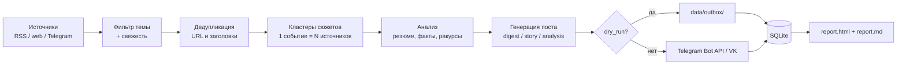

# Контент-завод

Автономная фабрика контента для **6 Telegram-каналов разных тем**. Сама
собирает новости из RSS и веба, находит один и тот же сюжет в разных
источниках, делает резюме и анализ, генерирует посты и публикует их по
расписанию, а затем считает аналитику.

Работает **бесплатно** и **из России**: Telegram Bot API, RSS, SQLite и
локальная суммаризация не требуют платных API, VPN и Docker. Нейросеть —
по желанию (локальная Ollama, бесплатный лимит GigaChat/YandexGPT или
приложение Dify Cloud).

> **Важно:** «полной автоматизации без настройки» не бывает. Нужно один раз
> создать бота, добавить его администратором в каналы и заполнить `.env`.
> По умолчанию включён безопасный режим `dry_run`: посты не публикуются, а
> сохраняются в `data/outbox/`.

## Каналы сети

Шесть публичных каналов проекта — 3 на английском и 3 на испанском. Единая
страница со всеми ссылками (хаб для био внешних площадок):
**<https://valdislavn-spec.github.io/content-factory/>**

| Язык | Канал | Ссылка |
|---|---|---|
| EN | Crypto & Blockchain — Bitcoin, Ethereum, markets, regulation | <https://t.me/HOOPY0007> |
| EN | AI News — models, products, policy, companies | <https://t.me/AINEWS0007> |
| EN | US Sports News — NFL, NBA, MLB, NHL, college football | <https://t.me/SPORTNews0007> |
| ES | ES Crypto & Blockchain — Bitcoin, Ethereum, mercados y regulación | <https://t.me/TechnologiesNews01> |
| ES | ES AI News — IA: modelos, productos, empresas y políticas | <https://t.me/WORLDNews0007> |
| ES | ES Sports News — fútbol: LaLiga, Liga MX, Argentina, MLS | <https://t.me/SPORTSAnalytics007> |

## Что умеет

- **Сбор** — RSS/Atom-ленты, веб-страницы, Telegram-каналы (последнее —
  опционально через Telethon).
- **Отбор по теме** — ключевые слова и стоп-слова у каждого канала; мусор не
  попадает в ленту.
- **Кластеризация** — одна и та же новость из разных источников склеивается в
  один сюжет; видно, сколько источников её подтверждают.
- **Суммаризация и анализ** — резюме, факты и цифры, тональность, разные
  ракурсы; режим `extractive` работает без моделей, `ollama`/`gigachat`/
  `yandexgpt`/`dify` — если хочется «живее».
- **Генерация постов** — форматы `digest` (подборка), `story` (один сюжет),
  `analysis` (разбор); хештеги, CTA, лимит длины, HTML для Telegram.
- **Русский и английский** — язык задаётся у канала (`language: ru|en`),
  готовый набор английских каналов — `config/channels.en.yaml`
  (см. [english.md](docs/english.md)).
- **Публикация** — Telegram Bot API (по умолчанию) и ВКонтакте
  (опционально); dry-run в файлы.
- **Расписание** — 3 публикации в день на канал по московскому времени;
  демон проверяет слоты и переживает перезапуски.
- **Аналитика** — `report.html` + `report.md`: посты, публикации, ошибки,
  источники, подписчики, форматы.
- **Экономия токенов** — кэш ответов LLM, объединённый анализ (резюме+тезисы
  одним запросом), компактные промпты и учёт токенов: −42% токенов на пост
  без потери качества (см. [llm.md](docs/llm.md#7-экономия-токенов-с-2026-11)).
- **Расширение** — новый канал, источник, соцсеть или LLM добавляются без
  переписывания ядра (см. [extending.md](docs/extending.md)).

## Архитектура



Текстом: **источники → фильтр темы → дедупликация → кластеры → анализ →
генерация → публикация (или outbox) → SQLite → отчёт**. Подробно — в
[architecture.md](docs/architecture.md).

## Почему бесплатно и работает из России

| Компонент | Решение | Стоимость |
|---|---|---|
| Публикация | Telegram Bot API (официальный, бесплатный) | 0 ₽ |
| Источники | RSS/Atom и обычные HTML-страницы | 0 ₽ |
| Хранение | SQLite — файл на диске | 0 ₽ |
| Суммаризация | встроенный extractive-режим (stdlib) | 0 ₽ |
| LLM (опция) | локальная Ollama (`qwen3.5:9b`, бесплатно и офлайн), бесплатный лимит GigaChat/YandexGPT или Dify Cloud | 0 ₽ |
| Запуск | Python + venv, без Docker | 0 ₽ |

- **Без OpenAI и платных API по умолчанию.** Единственная обязательная
  внешняя библиотека — `PyYAML`.
- **Docker Hub в РФ ограничен**, поэтому Docker не требуется: установка через
  `pip` и `venv`, автозапуск — systemd или Планировщик заданий Windows.
- **Офлайн-деградация:** если LLM недоступна, система продолжает публиковать в
  extractive-режиме.

## Быстрый старт за 10 минут

Нужен Python 3.9+ (рекомендуется 3.11–3.12) и интернет. Подробно — в
[setup.md](docs/setup.md).

### 1. Установка

```bash
cd content-factory
python3 -m venv .venv
source .venv/bin/activate          # Windows: .venv\Scripts\activate
python -m pip install --upgrade pip
python -m pip install -r requirements.txt
```

Windows (cmd): вместо `source .venv/bin/activate` — `.venv\Scripts\activate`.

### 2. Демо без токенов и сети

```bash
python -m content_factory init
python -m content_factory demo
```

Посты появятся в `samples/demo/outbox/`, отчёт откроется в браузере
(`samples/demo/reports/`). Это проверка, что всё установлено.

Готовые результаты демо уже лежат в репозитории — можно посмотреть, как это
выглядит, до запуска:

- [samples/demo/reports/report.html](samples/demo/reports/report.html) —
  HTML-отчёт аналитики (открывается в браузере);
- [samples/demo/reports/report.md](samples/demo/reports/report.md) —
  тот же отчёт в Markdown;
- [samples/demo/outbox/](samples/demo/outbox/) — 12 демо-постов (по 2 на
  канал) в `.txt` и `.html`; HTML-файл — самодостаточный предпросмотр с
  пометкой DRY RUN.

### 2.1. Локальная LLM (бесплатно, без ключей)

В проекте уже лежит локальный рантайм Ollama (`data/ollama/`, ~190 МБ; сами
модели туда же, `data/` в git не попадает). Модель `qwen3.5:9b` уже скачана
на этой машине; на другой — скачайте один раз:

```bash
bash scripts/start-ollama.sh start            # поднять сервер (127.0.0.1:11434)
bash scripts/start-ollama.sh pull qwen3.5:9b  # ~7.6 ГБ, один раз
./.venv/bin/python -m content_factory llm-test
```

Провайдер `ollama` уже включён в `config/settings.yaml` (модель, `num_ctx`,
`think: false`); если сервер не запущен, завод автоматически уйдёт в
`extractive`. Автозапуск после перезагрузки:
`bash scripts/install-launchd-macos.sh` (ставит и завод, и Ollama).
Подробнее — [docs/llm.md](docs/llm.md) §1.2 и [docs/setup.md](docs/setup.md) §2.1.

### 3. Бот и каналы

1. В Telegram создайте бота у **@BotFather** (`/newbot`) и получите токен.
2. Добавьте бота **администратором** в каждый канал с правом «Публикация
   сообщений».
3. Заполните `.env` (создан командой `init`):

```bash
TELEGRAM_BOT_TOKEN=123456789:AAH...
TELEGRAM_CHAT_ID_TECH_AI=@my_tech_channel
TELEGRAM_CHAT_ID_BUSINESS_FINANCE=@my_business_channel
TELEGRAM_CHAT_ID_SCIENCE_HEALTH=@my_science_channel
TELEGRAM_CHAT_ID_AUTO=@my_auto_channel
TELEGRAM_CHAT_ID_TRAVEL=@my_travel_channel
TELEGRAM_CHAT_ID_CULTURE=@my_culture_channel
CONTENT_FACTORY_DRY_RUN=true
```

`chat_id` — это `@username` канала или числовой `-100...`.

### 4. Проверка и dry-run

```bash
python -m content_factory channels          # 6 каналов и их режим
python -m content_factory sources check     # доступность источников
python -m content_factory run --channel all --dry-run
```

Посты — в `data/outbox/`. Посмотреть «как будет выглядеть» без публикации:

```bash
python -m content_factory preview --channel tech-ai --limit 3
```

### 5. Первая публикация

```bash
# один канал
python -m content_factory run --channel tech-ai --publish

# или: CONTENT_FACTORY_DRY_RUN=false в .env и обычный запуск
python -m content_factory run --channel all
```

> `--publish` игнорирует dry-run и публикует по-настоящему. Убедитесь, что бот
> добавлен в канал и вы проверили тексты.

### 6. Автономная работа

```bash
python -m content_factory daemon
```

Демон проверяет расписание каждые 60 секунд (настраивается
`app.daemon_interval_sec`). Остановка — `Ctrl+C`. Для автозапуска см.
`scripts/` и [operations.md](docs/operations.md).

## Шесть каналов

| id | Тема | Источники | Расписание (МСК) | Форматы |
|---|---|---|---|---|
| `tech-ai` | Технологии и ИИ | Habr, CNews, 3DNews, Telegram (опц.) | 09:00, 13:00, 19:00 | digest, story, analysis |
| `business-finance` | Бизнес и финансы | Коммерсантъ, РБК, Ведомости, Lenta, ТАСС | 08:30, 12:30, 18:30 | story, digest, analysis |
| `science-health` | Наука и здоровье | N+1, Naked Science, Элементы, ТАСС | 10:00, 15:00, 20:00 | story, analysis, digest |
| `auto` | Авто и транспорт | Kolesa.ru, 5 колесо, М24, Lenta, РИА | 09:30, 14:00, 19:30 | story, digest, analysis |
| `travel` | Путешествия | TourDom, RATA-news, М24, РИА | 11:00, 16:00, 21:00 | digest, story, analysis |
| `culture` | Культура и кино | InterMedia, Ревизор.ru, Кино-Новости, М24 | 10:30, 15:30, 20:30 | digest, story, analysis |

Все настройки — в `config/channels.yaml`; токены и id каналов — только в
`.env`. Как менять темы, источники, расписание и добавлять 7-й канал —
[channels.md](docs/channels.md).

## Команды CLI

Все команды — из корня проекта. `python` = Python внутри venv.

| Команда | Что делает |
|---|---|
| `python -m content_factory init` | создаёт `.env` из `.env.example` и каталоги `data/` |
| `python -m content_factory channels` | список каналов, расписание, режим публикации |
| `python -m content_factory sources check` | проверка доступности источников (всех каналов) |
| `python -m content_factory sources check --channel tech-ai` | проверка источников одного канала |
| `python -m content_factory run --channel all` | один прогон каналов (режим из настроек) |
| `python -m content_factory run --channel tech-ai --dry-run` | прогон без публикации, посты в `data/outbox/` |
| `python -m content_factory run --publish` | принудительная реальная публикация |
| `python -m content_factory run --channel all --max-posts 1` | не больше 1 поста на канал за прогон |
| `python -m content_factory preview --channel tech-ai` | показать будущие посты, не публикуя (посты не сохраняются) |
| `python -m content_factory preview --channel all --limit 5` | по 5 сюжетов на канал |
| `python -m content_factory daemon` | автономная работа по расписанию |
| `python -m content_factory daemon --once` | одна проверка расписания и выход (cron) |
| `python -m content_factory daemon --interval 300` | проверять расписание раз в 5 минут |
| `python -m content_factory report --days 7` | отчёт HTML+Markdown за 7 дней |
| `python -m content_factory report --days 7 --no-collect --open` | отчёт без сбора метрик, сразу открыть |
| `python -m content_factory metrics` | собрать срез метрик (подписчики, объёмы) |
| `python -m content_factory demo` | офлайн-демо без сети и токенов |
| `python -m content_factory llm-test` | проверить выбранную LLM |
| `python -m content_factory --version` | версия |
| `python -m content_factory --root /путь/к/проекту ...` | указать корень проекта |

- `--channel` принимает `all`, один id или несколько через запятую:
  `--channel tech-ai,culture`.
- Имена каналов — из таблицы выше; неизвестный id даст понятную ошибку.
- После `pip install -e .` доступна короткая команда `content-factory ...`,
  но `python -m content_factory` работает всегда и не требует установки пакета.

### Типичный день

```bash
# утром: проверить, что всё живо
python -m content_factory channels
python -m content_factory sources check

# посмотреть, что уйдёт в каналы
python -m content_factory preview --channel tech-ai

# разовый прогон, если демон не запущен (иначе он делает это сам)
python -m content_factory run --channel all

# вечером: аналитика
python -m content_factory report --days 1 --open
```

## Автономность

Демон можно запускать:

- **Linux** — systemd-сервис
  `scripts/systemd/content-factory.service` (Restart=always, автозапуск);
- **Windows** — Планировщик заданий, скрипт `scripts/windows/install-task.ps1`
  и `scripts/windows/run.bat`;
- **cron** — `daemon --once` каждые 5–10 минут (например, на VPS без
  systemd);
- **macOS** — cron/launchd по аналогии с Linux;
- **без своего ПК** — GitHub Actions: cron каждые 10 минут, SQLite и состояние
  расписания в кэше, публикация в Telegram. Пошагово —
  [cloud-actions.md](docs/cloud-actions.md).

Готовые скрипты:

```bash
bash scripts/install.sh     # venv, зависимости, .env, demo
bash scripts/run-daemon.sh  # запуск демона с логом в data/logs/daemon.out
bash scripts/check.sh       # sources check + тесты
```

Подробно про автозапуск, логи, бэкапы и мониторинг —
[operations.md](docs/operations.md).

## Аналитика

```bash
python -m content_factory report --days 7
```

Создаёт `data/reports/report.html` и `data/reports/report.md`. В отчёте:

- статьи, сюжеты, посты за период по каналам;
- сгенерировано / опубликовано / ошибки;
- распределение форматов и средняя длина постов;
- топ источников и топ тем;
- подписчики каналов;
- история запусков и последние ошибки.

Ежедневный отчёт роста (подписчики, просмотры/ER, дельты за сутки, лучший пост)
строится без Telethon — из публичного превью `t.me/s`:

```bash
python scripts/growth_report.py --send
```

Подробности: [docs/growth-analytics.md](docs/growth-analytics.md).

**Ограничения:** Telegram Bot API отдаёт число подписчиков
(`getChatMemberCount`), но **не отдаёт просмотры и реакции постов канала**.
Просмотры можно собирать опционально через Telethon (нужны `TG_API_ID` и
`TG_API_HASH`), без него — только ручной экспорт. Подписчики собираются только
при `dry_run=false` и наличии токена; в dry-run отчёт строится по локальной
базе.

## Расширение

- **Новый канал** — скопировать блок в `config/channels.yaml`, задать `id`,
  темы, источники, расписание и `TELEGRAM_CHAT_ID_*`. Код менять не нужно.
- **Новый источник** — RSS/HTML подключается записью в `sources`; для нового
  типа нужен адаптер (`SourceAdapter` в `content_factory/sources/`).
- **Документы как источник** — PDF/Word/PowerPoint/Excel/HTML можно
  использовать наравне с RSS и веб-страницами. Положите файлы в `data/inbox`
  и подключите источник `type: docs` (конвертация в Markdown через markitdown
  выполняется автоматически и кэшируется в `data/inbox/.markdown/`):

  ```yaml
  sources:
    - id: docs-inbox
      type: docs
      name: Документы
      options:
        dir: data/inbox
        max_items: 10
  ```

  Разовая конвертация вручную: `content-factory ingest --dir data/inbox`
  (или `content-factory ingest file1.pdf file2.docx --out data/inbox --json`).
  Конвертер — исполняемый `markitdown` из `tools/markitdown-venv/bin/markitdown`
  (переопределяется переменной `CONTENT_FACTORY_MARKITDOWN_BIN`).
- **Новая соцсеть** — публикатор (`Publisher` в
  `content_factory/publishers/`); VK уже реализован, по аналогии добавляются
  OK, Дзен, сайт, email.
- **Своя LLM** — провайдер в `content_factory/nlp/` + `llm.provider`.

Пошаговые примеры — [extending.md](docs/extending.md).

## Ограничения и правовые моменты

- **Бот должен быть администратором канала** с правом публикации — иначе
  Telegram не даст отправить сообщение.
- **Токены** храните только в `.env`; не коммитьте их. По умолчанию работает
  `dry_run`, реальная публикация включается осознанно.
- **Авторские права:** публикуйте **резюме со ссылками**, а не полные тексты
  чужих статей; указывайте источники; проверяйте условия RSS; не используйте
  чужие фото без лицензии.
- **Telegram ToS и лимиты:** не спамить, не превышать частоту (ориентир — до
  ~20 сообщений в минуту в канал), не публиковать запрещённый контент.
- **Медицина/финансы:** дисклеймеры обязательны («не является медицинской /
  инвестиционной рекомендацией»), не выдавайте аналитику за факты.
- **Персональные данные:** не публикуйте без согласия.
- **Просмотры** Bot API не отдаёт; **демон один на базу** (SQLite);
  кластеризация эвристическая и иногда ошибается.

Подробно — [legal.md](docs/legal.md) и [operations.md](docs/operations.md).

## FAQ

**Нужен ли VPN или платные API?**
Нет. Публикация — бесплатный Telegram Bot API, источники — RSS/веб. Ollama
работает локально. GigaChat/YandexGPT — опционально и с бесплатным лимитом,
Dify Cloud — если удобнее настраивать промпты и модели в веб-интерфейсе.

**Нужен ли Hugging Face?**
Для работы завода — нет. Локальная модель (`qwen3.5:9b`) ставится из
библиотеки Ollama и работает офлайн; HF не нужен ни как API, ни как хостинг
(его бесплатные кредиты Inference закончились, а Spaces — демо с квотами
1–2 запроса в сутки). HF полезен как каталог моделей/датасетов и для отдельного
eval-бенчмарка суммаризации — см. [docs/huggingface.md](docs/huggingface.md).

**Нужна ли видеокарта?**
Нет. Без модели завод работает в `extractive` на любом ноутбуке. Для локальной
LLM достаточно 16 ГБ RAM (9B-модель в Q4); на 8 ГБ ставьте `qwen3.5:4b`;
Apple Silicon/видеокарта ускоряют, но не обязательны.

**Сколько стоит?**
0 ₽: Python, SQLite, Bot API, extractive-режим. Платить можно только если
сами захотите облачную LLM сверх лимита.

**Что если источник перестал работать?**
Прогон не падает: ошибка попадает в лог и `runs.errors`, остальные источники
работают. Источник можно отключить (`enabled: false`) или заменить URL.

**Как поменять темы/каналы?**
Отредактируйте `config/channels.yaml` и перезапустите демон. Проверка —
`python -m content_factory channels`. Подробно — [channels.md](docs/channels.md).

**Как остановить публикацию?**
`CONTENT_FACTORY_DRY_RUN=true` в `.env` и перезапуск, либо
`sudo systemctl stop content-factory`. Канал можно выключить через
`enabled: false`.

**Где данные?**
`data/factory.sqlite3` (SQLite), `data/outbox/` (dry-run посты),
`data/reports/` (отчёты), `data/logs/factory.log` (логи). В git не попадают.

**Как перенести на сервер?**
Скопируйте проект, `config/`, `.env`, `data/factory.sqlite3`; создайте venv,
поставьте зависимости, настройте systemd. Подробно — [operations.md](docs/operations.md).

## Структура проекта

```
content-factory/
├── README.md                  # этот файл
├── config/
│   ├── settings.yaml          # общие настройки: режим, LLM, лимиты
│   └── channels.yaml          # 6 каналов: темы, источники, расписание
├── content_factory/
│   ├── cli.py                 # команды python -m content_factory ...
│   ├── config.py              # загрузка/валидация YAML и .env
│   ├── models.py              # контракты данных (dataclass)
│   ├── pipeline.py            # конвейер канала
│   ├── dedup.py               # дедупликация и кластеризация сюжетов
│   ├── storage.py             # SQLite
│   ├── utils.py               # HTTP, текст, даты, файлы
│   ├── logging_setup.py       # логи в консоль и data/logs/factory.log
│   ├── scheduler.py           # расписание и демон
│   ├── sources/               # RSS, web, Telegram
│   ├── nlp/                   # суммаризация, анализ, генерация, LLM
│   ├── publishers/            # Telegram, VK, dry-run
│   └── analytics/             # метрики и отчёт
├── docs/                      # архитектура, установка, каналы, LLM, право
├── scripts/                   # install/run/check, systemd, Windows
├── samples/                   # демо-данные и результаты demo
├── tests/                     # unittest-тесты
├── data/                      # рабочая база, outbox, отчёты, логи (не в git)
├── .env.example               # шаблон секретов
├── requirements.txt           # обязательные зависимости (PyYAML)
├── requirements-optional.txt  # Telethon — опционально
└── pyproject.toml             # пакет и консольная команда
```

## Документация

| Документ | О чём |
|---|---|
| [setup.md](docs/setup.md) | пошаговая установка Windows/Linux/macOS, бот, chat_id, первая публикация, ошибки |
| [architecture.md](docs/architecture.md) | компоненты, потоки данных, схема БД, отказоустойчивость |
| [channels.md](docs/channels.md) | 6 каналов, темы, источники, расписание, добавление канала |
| [llm.md](docs/llm.md) | режимы extractive/ollama/openai_compatible/gigachat/yandexgpt/dify, железо, проверка |
| [english.md](docs/english.md) | английские каналы и посты, channels.en.yaml, настройки языка, постинг каждый час |
| [integrations.md](docs/integrations.md) | Dify-приложения и World News API для новостей, трендов и SEO |
| [extending.md](docs/extending.md) | новый источник, соцсеть, формат, LLM |
| [operations.md](docs/operations.md) | автозапуск, логи, бэкапы, мониторинг, лимиты, VPS |
| [cloud-actions.md](docs/cloud-actions.md) | запуск без ПК и без Oracle: GitHub Actions, кэш состояния, dry-run, лимиты |
| [growth-analytics.md](docs/growth-analytics.md) | ежедневный отчёт роста: подписчики, просмотры, ER, дельты, сводка в Telegram |
| [promo/catalog-package.md](docs/promo/catalog-package.md) | карточки для каталогов: описания 120–200, категории, ключевые слова; [promo/vp-outreach.md](docs/promo/vp-outreach.md) — ВП-шаблоны и трекер |
| [promo/email-newsletter-free.md](docs/promo/email-newsletter-free.md) | бесплатные email-рассылки: GitHub-проекты (Listmonk, Ghost, Keila), free-тарифы Brevo/Resend/Mailgun/SendPulse, сбор адресов и сценарии запуска |
| [plan.md](docs/plan.md) | чек-лист запуска на 7 дней и дорожная карта |
| [free-cloud.md](docs/free-cloud.md) | бесплатные облачные варианты: сбор новостей, LLM, хостинг, автопостинг, рецепты Oracle/GitHub Actions/Apps Script/n8n |
| [legal.md](docs/legal.md) | авторские права, ToS, дисклеймеры, ответственность |

## Мультимодельный слой

Если нужен «редакционный мозг» из нескольких моделей и MCP-инструментов,
рядом есть проект [mcp-content-factory](../mcp-content-factory/README.md):
5 ролей (исследователь, автор, критик, редактор), маршрутизация моделей,
fallback, MCP-сервер с инструментами и офлайн-демо.

## Лицензия

MIT (см. `pyproject.toml`). Ответственность за публикуемый контент несёт
владелец каналов.
