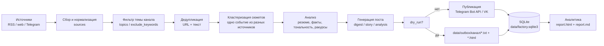

# Архитектура контент-завода

Документ описывает, из каких модулей состоит проект, как данные проходят от
источника до опубликованного поста и где что хранится. Если вы просто хотите
запустить проект — начните с [setup.md](setup.md), а сюда возвращайтесь, когда
нужно что-то доработать.

## 1. Принципы

1. **Бесплатно и из России.** Единственная обязательная внешняя зависимость —
   `PyYAML`. Всё остальное — стандартная библиотека Python: HTTP-клиент,
   SQLite, HTML-парсер, суммаризация. Публикация — через бесплатный Telegram
   Bot API. Docker не требуется (Docker Hub в РФ ограничен).
2. **Секреты — только в `.env`.** В `config/*.yaml` нет токенов: там лежат
   темы, источники, расписание; токены и id каналов подставляются из
   переменных окружения.
3. **Безопасный по умолчанию.** `dry_run: true` — посты не уходят в каналы,
   а складываются в `data/outbox/`. Реальная публикация включается осознанно.
4. **Без «магии».** Один запуск конвейера — один канал: собрали → отобрали по
   теме → склеили в сюжеты → проанализировали → сгенерировали → опубликовали →
   записали в SQLite. Демон просто повторяет это по расписанию.
5. **Офлайн-деградация.** Если локальная LLM недоступна или отвечает ошибкой,
   система откатывается на бесплатный extractive-режим и продолжает работать.

## 2. Поток данных

Текстом: **источники → фильтр темы → дедупликация/кластеры → анализ →
генерация → публикация (или outbox) → SQLite → отчёт**. Каждый шаг пишет
результат в базу, поэтому состояние переживает перезапуск процесса.

## 3. Компоненты

| Компонент | Файл(ы) | Ответственность |
|---|---|---|
| Конфигурация | `content_factory/config.py` | Загрузка `config/settings.yaml` + `config/channels.yaml`, глубокое слияние с дефолтами, валидация, пути, `.env` |
| Модели данных | `content_factory/models.py` | Dataclass-контракты между всеми модулями: `Article`, `StoryCluster`, `Analysis`, `GeneratedPost`, `PublishResult`, `RunResult`, `ChannelConfig`, `SourceConfig` |
| Утилиты | `content_factory/utils.py` | HTTP GET без зависимостей (gzip, ретраи, кодировки), очистка HTML, токенизация, Jaccard, даты, `.env`, атомарная запись файлов |
| Хранилище | `content_factory/storage.py` | SQLite-схема и методы: статьи, посты, публикации, метрики, запуски |
| Логирование | `content_factory/logging_setup.py` | Консоль + ротация `data/logs/factory.log` (2 МБ × 3) |
| Источники | `content_factory/sources/` | Адаптеры RSS/web/Telegram, нормализация статей, фильтр темы |
| Дедупликация | `content_factory/dedup.py` | Похожесть заголовков, склейка статей в сюжеты (`cluster_articles`), защита от повторов (`is_duplicate_title`) |
| NLP | `content_factory/nlp/` | Суммаризация, анализ кластера, генерация поста, LLM-провайдеры (`extractive`, `ollama`, `openai_compatible`, `gigachat`, `yandexgpt`, `dify`, `cloudflare`) |
| Конвейер | `content_factory/pipeline.py` | Сборка шагов в один запуск канала, решение «публиковать/не публиковать», dry-run |
| Публикация | `content_factory/publishers/` | Telegram Bot API, ВКонтакте, dry-run/outbox |
| Планировщик | `content_factory/scheduler.py` | Выбор каналов, у которых наступило время слота, защита от повторной публикации |
| Аналитика | `content_factory/analytics/` | Сбор метрик, HTML+Markdown отчёт |
| CLI | `content_factory/cli.py` | Команды для человека: список каналов, проверка источников, прогон, превью, демо, отчёт, проверка LLM, демон |

Модули внутри `sources/`, `nlp/`, `publishers/`, `analytics/` — обычные
Python-пакеты; интерфейсы расширения описаны в [extending.md](extending.md).

## 4. Контракты данных

Все модули обмениваются dataclass-ами из `models.py`; словари «напрямую» не
используются. Ключевые структуры:

- `Article` — новость: `id`, `title`, `url`, `source_id`, `source_name`,
  `published_at`, `text`, `summary`, `weighted_source_score`, `meta`.
- `StoryCluster` — сюжет: список `articles`, `coverage` (число разных
  источников), `score`, `relevance`, `key_terms`.
- `Analysis` — результат анализа: `summary`, `bullets`, `key_terms`,
  `sentiment`, `numbers`, `perspectives`, `source_count`, `source_names`.
- `GeneratedPost` — готовый пост (HTML для Telegram): `id`, `channel_id`,
  `cluster_id`, `format`, `text`, `hashtags`, `sources`.
- `PublishResult` — результат по одному паблишеру: `ok`, `external_id`, `url`,
  `error`, `dry_run`.
- `RunResult` — итог прогона канала: счётчики статей/кластеров/постов, ошибки,
  `dry_run`, `started_at`/`finished_at`.

Время внутри системы — timezone-aware UTC (`models.utcnow()`); в отчётах и
расписании используется московское время (UTC+3, `MSK`). В России перехода на
летнее время нет, поэтому фиксированный сдвиг корректен.

## 5. Схема базы данных

Файл по умолчанию — `data/factory.sqlite3`. SQLite выбирается потому, что это
файл без сервера: бэкап — копирование, перенос — копирование. Схема создаётся
автоматически при первом обращении (`storage.py::SCHEMA`).

### `articles` — всё, что собрали

| Поле | Тип | Смысл |
|---|---|---|
| `channel_id` | TEXT | Канал, для которого собрана статья (PK-часть) |
| `article_id` | TEXT | Детерминированный id (хэш нормализованного URL) |
| `url_hash` | TEXT | Хэш URL без UTM-меток — для дедупликации |
| `title`, `url`, `source_id`, `source_name` | TEXT | Заголовок, ссылка, источник |
| `published_at`, `fetched_at` | TEXT (ISO) | Дата публикации и дата сбора |
| `text`, `summary`, `language` | TEXT | Текст/анонс, язык |
| `meta` | TEXT (JSON) | Служебные поля адаптера |

Первичный ключ — `(channel_id, article_id)`, поэтому одна и та же новость
может встречаться в разных каналах, но не дублируется внутри канала.

### `posts` — сгенерированные посты

`post_id` (PK), `channel_id`, `cluster_id`, `format`, `text`, `hashtags`
(JSON), `sources` (JSON), `created_at`, `status` (`generated` — создан,
`published` — успешно опубликован), `score`, `external_url`, `meta`.
Режим dry-run фиксируется не в статусе поста, а в журнале `publishes`
(поле `dry_run`).

### `publishes` — журнал публикаций

`id` (PK), `channel_id`, `post_id`, `publisher` (`telegram` / `vk`), `ok`,
`external_id` (message_id), `url`, `error`, `dry_run`, `published_at`.
Журнал нужен, чтобы отчёт показывал реальные успехи/ошибки, а не только
намерения.

### `metrics` — срезы метрик

`id` (PK), `channel_id`, `collected_at`, `subscribers`, `payload` (JSON:
число статей/постов/форматов, топ-источники, топ-термины, средняя длина).
Метрики — это **снимки**: подписчики приходят из Telegram Bot API, просмотры
постов Bot API не отдаёт (см. [operations.md](operations.md)).

### `telegram_posts` — метрики постов Telegram

`channel_id`, `message_id` (PK в паре), `posted_at`, `views`, `forwards`,
`reactions`, `replies`, `text_preview`, `url`, `collected_at`.
Заполняется командой `telegram-metrics` через Telethon; повторный запуск
обновляет запись (upsert), а не дублирует.

### `telegram_channel_metrics` — срезы Telegram-метрик

`id` (PK), `channel_id`, `collected_at`, `subscribers`, `posts_analyzed`,
`total_views`, `avg_views`, `total_reactions`, `total_forwards`, `er`, `payload`
(JSON). Используется блоком «Telegram-метрики» в отчёте.

### `runs` — история запусков

`id` (PK), `channel_id`, `started_at`, `finished_at`, `duration_sec`,
`articles_fetched`, `articles_new`, `clusters`, `posts_generated`,
`posts_published`, `errors` (JSON), `dry_run`.

Индексы: `(channel_id, published_at)` у статей, `(channel_id, created_at)` у
постов, `(channel_id, published_at)` у публикаций, `(channel_id, collected_at)`
у метрик, `(channel_id, collected_at)` у Telegram-метрик,
`(channel_id, posted_at)` у постов Telegram, `(channel_id, started_at)` у запусков.

## 6. Один запуск конвейера

1. Загрузить настройки и канал (`Settings.load`, `load_channels`).
2. Проверить каталоги (`Settings.ensure_dirs`), открыть SQLite, настроить лог.
3. Собрать статьи из включённых источников (последовательно; ошибка одного
   источника не роняет остальные).
4. Отфильтровать по `topics` / `exclude_keywords`, обрезать окном
   `lookback_hours`, удалить уже виденное и дубли по URL/тексту.
5. Склеить статьи в сюжеты (`cluster_similarity`, `cluster_max_age_hours`),
   отобрать по релевантности, весу источников и `min_cluster_sources`.
6. Проанализировать выбранные сюжеты: резюме, факты/цифры, тональность,
   разные ракурсы из разных источников.
7. Сгенерировать посты (не больше `max_posts_per_run` за запуск), проверить
   `banned_words`, минимальную длину, лимит канала.
8. Если `dry_run` — сохранить текст в `data/outbox/<канал>/`
   (`<дата>-<id>.txt` и `.html`) и записать в `publishes` строку с
   `dry_run=1`. Иначе — отправить в Telegram (и VK, если настроен), записать
   `publishes` с результатом.
9. Записать `RunResult` в `runs`, залогировать итог.

## 7. Идемпотентность и дедупликация

- **Статья.** `article_id` — хэш нормализованного URL (`normalize_url`
  убирает UTM/якоря, приводит схему и домен к нижнему регистру). Вставка —
  `INSERT OR IGNORE`, повторный сбор того же URL ничего не дублирует.
- **Кластер.** Сюжеты строятся заново в каждом запуске из свежих статей;
  окно `lookback_hours` не даёт бесконечно переобрабатывать старьё.
- **Пост.** Перед генерацией проверяются заголовки постов канала за окно
  `pipeline.post_duplicate_window_hours` (по умолчанию 72 часа): похожие
  сюжеты не публикуются повторно.
- **Повторный запуск демона.** Отработанные слоты хранятся в
  `data/schedule_state.json` и не публикуются повторно: слот помечается
  выполненным после обработки. Если отправка не удалась (например, бот не
  админ), ошибка остаётся в `publishes.error` и `runs.errors`, но
  автоматического повтора нет — исправьте причину и при необходимости
  опубликуйте пост вручную. Следующие слоты возьмут новые сюжеты.
- **Защита от повторной публикации.** У поста детерминированный `post_id`
  (канал + сюжет + формат). Если такой пост уже записан в `posts`
  (`INSERT OR IGNORE`), конвейер пропускает его и повторно не отправляет.

## 8. Отказоустойчивость

| Сбой | Поведение |
|---|---|
| Источник отдал 404/500/таймаут | Ретраи (`request_retries`, backoff), затем источник пропускается с предупреждением в лог; остальные работают |
| Источник «умер» навсегда | Пост не генерируется; в `runs.errors` будет запись; источник можно отключить `enabled: false` |
| Ollama/LLM недоступна | Ошибка логируется, включается extractive-режим (резюме из текста без модели) |
| Telegram API вернул ошибку | Ошибка в `publishes.error`, пост остаётся в статусе `generated`, другие каналы не страдают; автоматического повтора нет — слот завершится, ошибка будет в отчёте |
| Процесс упал | SQLite-транзакции не оставляют «полупостов»; демон поднимается systemd/Планировщиком |
| Нет сети | Прогон завершится ошибками источников, но не сломает базу; report строится по накопленным данным |
| Канал не настроен (нет chat_id) | При `dry_run` пост идёт в outbox; при реальной публикации — ошибка «не задан chat_id» в `publishes.error`, остальные каналы не страдают |

Отдельный канал не блокирует остальные: конвейер вызывается по одному каналу,
а демон перебирает каналы независимо.

## 9. Безопасность

- Токены (Telegram, VK, GigaChat, YandexGPT, Dify, Telethon-сессия) хранятся только
  в `.env`; `.gitignore` исключает `.env`, `data/`, `*.sqlite3`.
- В документации и логах токены не печатаются; при показе — маскируются.
- По умолчанию `dry_run: true`; реальная публикация включается в `.env`.
- Бот должен быть **администратором канала** с правом публикации — без этого
  Telegram вернёт ошибку прав.
- HTML-only форматирование: текст постов экранируется, чтобы не сломать
  разметку Telegram.
- База и конфиги — локальные файлы; доступ к ним = доступ к контенту и
  истории. На сервере ограничьте права на каталог проекта.

## 10. Точки расширения

- **Новый источник** — адаптер в `sources/` + запись в `config/channels.yaml`.
- **Новая соцсеть** — паблишер в `publishers/` + `publisher_ids` у канала.
- **Новая LLM** — провайдер в `nlp/` + `llm.provider` в настройках.
- **Новый формат поста** — генератор в `nlp/` + допустимое значение в
  `formats` канала.
- **Новый отчёт** — модуль в `analytics/`, данные уже лежат в SQLite.

Подробности — [extending.md](extending.md).

## 11. Ограничения архитектуры

- **Просмотры постов.** Bot API не отдаёт статистику просмотров/реакций
  постов канала. Подписчики — отдаёт (`getChatMemberCount`, только при
  выключенном dry-run). Просмотры можно собирать опционально через Telethon
  (`TG_API_ID`, `TG_API_HASH`); без него — ручной экспорт из Telegram.
- **Один демон.** SQLite работает в WAL-режиме (читатели не блокируют
  писателя), а второй `daemon` останавливается на `data/locks/daemon.lock`.
  Два демона на одной базе больше не запускаются случайно.
- **Медиа.** Telegram-публикатор умеет `sendPhoto`: карточка поста
  (`post.meta.card_path`), картинка статьи (`image_url`) или фото из Dify.
  Видео пока не поддерживается; при отсутствии картинки пост уходит текстом.
- **Кластеризация без ML.** Взвешенный TF-IDF по заголовку и телу +
  complete-linkage и временное окно (`cluster_max_age_hours`). Это убирает
  транзитивную склейку «A~B~C, хотя A и C разные» и находит пересказы с
  разными заголовками, но семантические paraphrase без общих слов всё ещё
  могут пропускаться. Embeddings/LLM — отдельный эксперимент, не включён по
  умолчанию.
- **Docker.** Есть `Dockerfile`, `docker-compose.yml` и systemd-юнит;
  контейнер не обязателен, но рекомендуется для VPS и авто-рестарта.
