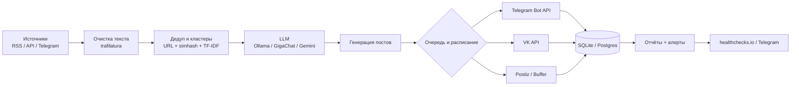

# Бесплатное облако для контент-завода: сбор новостей, генерация и автопостинг

> Проверено 26 октября 2026 года. Бесплатные тарифы меняются: цифры ниже —
> ориентиры, а не гарантия. Перед запуском сверяйтесь с официальными
> страницами (ссылки в конце). Документ дополняет [operations.md](operations.md)
> (автозапуск, бэкапы, мониторинг) и [llm.md](llm.md) (режимы LLM).
>
> Рецепты собраны по документации и тарифным страницам провайдеров; они не
> тестировались на вашем аккаунте — шаги проверяйте по консоли провайдера.

Это ответ на вопрос «как собрать профессиональный контент-завод и
автопостинг **полностью бесплатно**, используя облачные системы». Речь не о
«парсере за 10 минут», а о схеме, которая круглосуточно собирает новости,
делает резюме, публикует по расписанию и не разваливается.

## 0. Короткий ответ: четыре рабочих стека

| Стек | Из чего | Плюсы | Минусы | Кому |
|---|---|---|---|---|
| **A. Без сервера** | Google Apps Script + Google News RSS + Telegram Bot API (+ GigaChat по желанию) | 0 ₽, не нужна карта, запуск за вечер | лимит 6 минут на исполнение, нет SQLite, слабая аналитика | 1–2 канала, MVP |
| **B. Свой сервер 24/7** | Oracle Cloud Always Free (ARM 4 OCPU / 24 ГБ) + этот проект + Ollama + systemd | 0 ₽, полный контроль, SQLite, 6 каналов, локальная LLM | нужна карта для регистрации, Oracle может отказать, администрирование | **профессиональный запуск** |
| **C. No-code** | n8n Community Edition на том же бесплатном сервере + Telegram/VK | 0 ₽, визуальные сценарии, много интеграций | меньше контроля, обновления, память | если не хочется кода |
| **D. CI-cron** | GitHub Actions (публичный репозиторий) + этот проект | 0 ₽, без карты, без сервера | состояние между запусками эфемерное, задержки расписания | если сервер не хочется |

**Рекомендация по умолчанию:** стек **B**. Oracle Always Free — практически
единственный «бесплатный навсегда» вариант, где можно круглосуточно держать
Python, SQLite и локальную LLM на 24 ГБ RAM. Всё остальное — обходные пути на
случай, если Oracle не даёт аккаунт или карта не проходит.

Главное правило: **бесплатно ≠ без ограничений**. У каждого бесплатного
тарифа есть лимиты, спящие режимы, «пробные» гранты и условия, которые
меняются. Ниже у каждого варианта указано, где ловушка.

> Если Oracle недоступен (карта, регион, регистрация) — не тратьте на него
> время: для этого проекта есть готовый запуск без ПК через GitHub Actions —
> [cloud-actions.md](cloud-actions.md).

---

## 1. Что уже умеет проект и чего не хватает

Проект в этом репозитории уже закрывает большую часть «завода»:

- сбор RSS/веб/Telegram, фильтр по темам и стоп-словам;
- дедупликация и кластеризация сюжетов;
- суммаризация в режиме `extractive` (без моделей) или через LLM;
- генерация постов `digest` / `story` / `analysis`, HTML для Telegram;
- публикация в Telegram (Bot API) и VK, расписание, dry-run;
- SQLite, отчёты HTML/Markdown, метрики.

Чего не хватает для «облака»: круглосуточного хоста, LLM без локального ПК,
бэкапов, мониторинга, мультиплатформенности и понимания, где заканчивается
бесплатное. Этому посвящены разделы ниже.

---

## 2. Архитектура: что где бесплатно



| Слой | Бесплатные варианты | Где ограничение |
|---|---|---|
| Сбор | RSS/Atom, Google News RSS, Yandex News RSS, Telegram через RSSHub/Telethon, NewsAPI/GNews/Mediastack (free), VK API, Reddit API | free-тарифы API — для разработки; Telegram-парсинг — риск бана |
| Хранение | SQLite (файл), Supabase/Neon (free), Cloudflare D1/R2, Google Sheets | Supabase засыпает, D1 — только JS-воркеры |
| Очистка/дедуп | Python: feedparser, trafilatura, simhash, rapidfuzz, scikit-learn | — |
| LLM | Ollama (локально), GigaChat (free-лимит), YandexGPT (грант), Gemini free, Groq/OpenRouter/Mistral free | геодоступ, лимиты, обучение на данных |
| Хостинг | Oracle Always Free, GCP e2-micro, GitHub Actions, Apps Script, Cloudflare Workers, HF Spaces | карта, сон, квоты, эфемерность |
| Публикация | Telegram Bot API, VK API, OK API, X free, Meta Graph, LinkedIn, Mastodon/Bluesky | лимиты, ревью приложений, запрет спама |
| Планировщик | systemd/cron, GitHub Actions cron, Apps Script триггеры, Cloudflare cron, n8n/Make | задержки, лимиты запусков |
| Аналитика | Bot API (подписчики), отчёт проекта, TGStat/Telemetr free, Метрика | просмотры канала Bot API не отдаёт |
| Мониторинг | healthchecks.io, UptimeRobot, Better Stack, ntfy, Telegram-алерты | бесплатные лимиты проверок |

---

## 3. Сбор новостей бесплатно

### 3.1. RSS/Atom — основа профессионального сбора

RSS — единственный канал, который бесплатен, легален и стабилен. Почти все
качественные издания отдают ленты. В проекте RSS уже реализован; добавляйте
источники в `config/channels.yaml`.

Что использовать:

- **RSS изданий** — Хабр, CNews, 3DNews, РБК, Коммерсантъ, ТАСС, N+1,
  InterMedia и т. д. (примеры уже в проекте).
- **Google News RSS** — `https://news.google.com/rss/search?q=...&hl=ru&gl=RU&ceid=RU:ru`.
  Бесплатно, без ключа, отлично работает как «широкий» слой. Это не
  официальный API: Google может менять формат и блокировать частые запросы.
- **Яндекс.Новости RSS** — `https://news.yandex.ru/index.rss` (и тематические
  ленты). Неофициально, но бесплатно.
- **Press-release ленты** — EurekAlert, PR Newswire, пресс-центры компаний и
  ведомств. Это первоисточники, самый высокий уровень доверия.
- **Telegram-каналы → RSS** — через [RSSHub](https://docs.rsshub.app/)
  (self-hosted бесплатно) или публичные инстансы. Публичные часто
  перегружены; для стабильности RSSHub лучше поднять рядом с заводом.
- **Google Alerts** — бесплатные письма по ключевым словам; их можно
  разбирать скриптом (Apps Script имеет доступ к Gmail) или пересылать в RSS
  через сторонние мосты.
- **Сайты без RSS** — [changedetection.io](https://changedetection.io/) или
  [Huginn](https://github.com/huginn/huginn) (self-hosted, бесплатно) следят
  за изменениями страниц.
- **Человеческий слой** — Feedly/Inoreader free (см. ниже) для ручного
  просмотра и отбора; автоматизация всё равно на RSS.

Профессиональные правила сбора:

1. **Условный GET** (`ETag`, `Last-Modified`) и кэш — не дёргать источник зря.
2. **Таймауты и ретраи с backoff** — уже есть в проекте (`request_timeout`,
   `request_retries`).
3. **Уважать `robots.txt` и правила RSS.** Некоторые издания разрешают только
   личный просмотр и запрещают перепубликацию.
4. **Не парсить полные тексты платных статей.** Резюме + ссылка — безопаснее
   и этичнее.
5. **Хранить сырой HTML/текст** — для проверки фактов и разбора инцидентов.
6. **Вести реестр источников**: URL, тип, тема, язык, доверие, частота,
   лицензия, статус.

### 3.2. Новостные API с бесплатным тарифом

| API | Бесплатный лимит (ориентир) | Подвох |
|---|---|---|
| [NewsAPI](https://newsapi.org/pricing) | 100 запросов/день, задержка 24 ч | **только разработка и тесты**, production запрещён; полных текстов нет |
| [GNews](https://gnews.io/) | ~100 запросов/день | задержки, ограниченная история |
| [Mediastack](https://mediastack.com/) | ~500 запросов/мес | мало для 6 каналов |
| [The Guardian Open Platform](https://open-platform.theguardian.com/) | бесплатный ключ, щедрый лимит | только Guardian |
| [NewsData.io](https://newsdata.io/) | ~200 кредитов/день | кредиты тратятся на запросы |
| [Reddit API](https://www.reddit.com/dev/api/) | ~100 запросов/мин | нужны OAuth, правила сабреддитов |
| Hacker News (Algolia) | бесплатно, без ключа | только HN |
| arXiv / PubMed / Crossref | бесплатно | наука, не «новости» |

Вывод: **новостные API — дополнение, а не замена RSS**. Для 6 каналов
бесплатных лимитов NewsAPI/GNews хватит только на узкий мониторинг; основной
поток — RSS. И почти все free-тарифы API запрещают production-использование —
это нарушение условий, а не «экономия».

### 3.3. Telegram, VK и соцсети

- **Свои каналы** — Bot API, бесплатно (см. раздел 7).
- **Чтение чужих каналов** — только через официальный Bot API нельзя. Варианты:
  Telethon/юзербот (бесплатно, но риск бана аккаунта), RSSHub, публичные
  Telegram-мосты. В проекте Telethon опционален (`requirements-optional.txt`) —
  используйте осторожно и на отдельном аккаунте.
- **VK** — API бесплатен: `newsfeed.search`, `wall.get` для сообществ, токен
  пользователя/сообщества. Нужно приложение VK ID.
- **OK** — API для групп, бесплатно, нужен токен приложения.
- **X/Twitter** — free-тариф даёт около 500 постов в месяц на запись и очень
  мало чтения; для мониторинга почти бесполезен.
- **Reddit** — бесплатный API с OAuth, но у сабреддитов свои правила.

### 3.4. Слой агрегаторов для человека

- [Feedly](https://feedly.com/pricing) — free-тариф с ограниченным числом
  источников; AI-функции платные.
- [Inoreader](https://www.inoreader.com/pricing) — free с ограничением подписок.
- Оба хороши как «пульт» редактора, но не как автоматизация.

### 3.5. Проверка качества (то, что отличает профессионала)

- Минимум **2 источника** на сюжет (`min_cluster_sources: 2` в настройках).
- Ссылка на **первоисточник**, а не на пересказ.
- Проверка даты и свежести (`lookback_hours`).
- Отделение факта от комментария; для медицины/финансов — дисклеймеры
  ([legal.md](legal.md)).
- Человеческая проверка первых недель (`dry_run`, `preview`).

---

## 4. Очистка, дедупликация, кластеризация — бесплатные библиотеки

Всё это работает на обычном CPU и не требует денег:

| Задача | Инструмент |
|---|---|
| Парсинг RSS/Atom | `feedparser` |
| Извлечение текста из HTML | `trafilatura`, `readability-lxml` |
| Язык | `langdetect`, `lingua` |
| Дедуп по URL | канонизация URL (уже в проекте) |
| Похожесть заголовков | `simhash`, `rapidfuzz` |
| Кластеризация сюжетов | TF-IDF + косинус (`scikit-learn`) |
| Полнотекстовый поиск | SQLite FTS5 |
| Эмбеддинги (опционально) | `sentence-transformers` локально |

Проект уже делает дедуп и кластеризацию эвристиками — этого достаточно для
6 каналов. Не тащите векторную БД, пока не упрётесь в качество.

---

## 5. Генерация контента бесплатно

### 5.1. LLM: варианты и подвохи

| Провайдер | Бесплатно | Доступ из РФ | Данные | Комментарий |
|---|---|---|---|---|
| **Ollama локально** | полностью | да | никуда не уходят | нужен сервер с RAM; проект ставит Ollama в `data/ollama/` (16 ГБ RAM хватает на 9B) |
| **GigaChat API** (Сбер) | бесплатный лимит для физлиц | да | по условиям Сбера | проект поддерживает; лимиты — в кабинете |
| **YandexGPT** | пробный грант Yandex Cloud | да | по условиям Yandex | после гранта платно |
| **Gemini API** | free-tier с лимитами | официально нет | **на free-тарифе используются для улучшения продуктов** | нужен зарубежный аккаунт/VPN; риск нарушения ToS |
| **Groq** | free-tier с лимитами RPM/RPD | проверяйте | по условиям | быстрый, открытые модели |
| **OpenRouter** | модели с суффиксом `:free` | проверяйте | по условиям модели | удобно для экспериментов |
| **Mistral** | free-tier для экспериментов | проверяйте | по условиям | европейский провайдер |
| **Cloudflare Workers AI** | ~10 000 neurons/день | проверяйте | по условиям | только из Worker |
| **GitHub Models** | бесплатный доступ с лимитами | проверяйте | по условиям | удобно для прототипа |
| **Cohere** | trial-ключ с ограничениями | проверяйте | по условиям | не для потока |
| **Hugging Face** | **бесплатных кредитов Inference больше нет** (free = 0, PRO = $2/мес) | проверяйте | по условиям | как LLM-API — платный; бесплатно — только как источник локальных моделей и датасетов (см. [huggingface.md](huggingface.md)) |

**Что выбрать:**

- **Из России, 24/7, без платежей** → `ollama` локально (`qwen3.5:9b` на 16 ГБ
  RAM, `qwen3.5:4b` на 8 ГБ) либо `gigachat` в пределах лимита.
- **Есть зарубежный аккаунт** → Gemini Flash free; но помните про обучение на
  данных free-тарифа и геоограничения.
- **Нужна скорость и качество** → Groq/OpenRouter free, если доступны.
- **Совсем без LLM** → `extractive` в проекте; для новостного канала это
  рабочий режим, а не «заглушка».

Практика:

- `temperature` 0.2–0.4, требование ссылок и запрет выдумывать факты — уже
  заложены в промпты проекта.
- После генерации проверяйте цифры и имена: LLM ошибается правдоподобно.
- Для медицины/финансов — только с человеческой проверкой и дисклеймером.

### 5.2. Картинки и медиа бесплатно

- [Pollinations](https://pollinations.ai/) — генерация изображений по URL, без
  ключа; проверяйте лицензию и условия.
- [Pexels](https://www.pexels.com/api/), [Unsplash](https://unsplash.com/developers),
  [Pixabay](https://pixabay.com/api/docs/) — бесплатные API при соблюдении
  лицензий и атрибуции.
- [Openverse](https://openverse.org/) — поиск изображений с CC-лицензиями.
- Cloudflare Workers AI / HF — генерация в пределах бесплатных квот.

Не берите фотографии из новостей без лицензии — это самая частая претензия.

### 5.3. Озвучка и видео (если нужно)

- **TTS**: Piper, Silero (локально, бесплатно), Edge TTS (неофициально,
  бесплатно, но без гарантий).
- **Видео**: бесплатные тарифы слабые и с водяными знаками; для новостного
  канала видео лучше делать вручную или отложить.

---

## 6. Хостинг и оркестрация

### 6.1. Oracle Cloud Always Free — основной вариант

Официально: [oracle.com/cloud/free](https://www.oracle.com/cloud/free/).
Always Free — это не trial, а бессрочные ресурсы в пределах квот:

- до **4 OCPU Ampere A1 (ARM)** и **24 ГБ RAM** суммарно;
- **200 ГБ** блочного хранилища;
- **10 ТБ** исходящего трафика в месяц;
- плюс два небольших AMD-инстанса, object storage, load balancer и т. д.

Этого хватает на Python-завод, SQLite, Ollama с 7B-моделью и запасом.

**Подвохи, о которых надо знать заранее:**

- **Нужна карта** для верификации (российские карты часто не проходят;
  виртуальные иногда работают). Списывается и возвращается небольшая сумма.
- **Один аккаунт на человека**, мультиаккаунты запрещены.
- **Регион** выбирайте ближайший и тот, где есть ёмкость A1; при ошибке
  capacity пробуйте другой availability domain или позже.
- **Простаивающие ресурсы** Oracle вправе отозвать; аккаунт без активности
  30+ дней может быть признан заброшенным. Для завода с cron-нагрузкой риск
  ниже, но мониторинг обязателен.
- **Не нажимайте «Upgrade to Pay As You Go»**, если не готовы платить: после
  апгрейда часть ресурсов может выйти за Always Free.

Пошаговый рецепт — в разделе 8.1.

### 6.2. Google Cloud Free Tier

- **e2-micro**: 1 ГБ RAM (2 разделяемых vCPU), 30 ГБ диска, 1 ГБ исходящего
  трафика в месяц, только в нескольких регионах США.
- Нужна карта; российские карты часто не проходят.
- Хватит на `extractive`-режим с swap, но не на Ollama. Для 6 каналов —
  впритык по RAM; ставьте swap и не запускайте тяжёлые модели.

### 6.3. GitHub Actions — бесплатный cron без сервера

- **Публичный репозиторий** — минуты не ограничены (стандартные runners).
- **Приватный** — около 2 000 минут Linux в месяц на Free-плане.
- Cron с шагом от 5 минут, но запуск может задерживаться; job — до 6 часов.
- В публичных репозиториях scheduled workflows отключаются после ~60 дней без
  активности.
- Файловая система эфемерная: SQLite и `data/schedule_state.json` нужно
  сохранять между запусками (кэш, artifact или commit в отдельную ветку).

Схема: `python -m content_factory daemon --once` каждые 10–15 минут. Плюс —
не нужен сервер и карта; минус — состояние и задержки. Полный workflow — в
разделе 8.2.

### 6.4. Google Apps Script — без сервера и без карты

Бесплатные квоты личного аккаунта (ориентировочно):

- 20 000 вызовов `UrlFetch` в день;
- 90 минут суммарного времени триггеров в день;
- 6 минут на одно исполнение;
- триггеры с шагом от 1 минуты.

Этого достаточно для лёгкого завода: RSS → дедуп в `CacheService` → Telegram.
Нет SQLite, нет тяжёлой аналитики, но для 1–2 каналов и дайджестов — отлично.
Пример кода — в разделе 8.4.

### 6.5. Cloudflare Workers — если нравится JS

Бесплатно (ориентиры): ~100 000 запросов в день, 10 мс CPU на запрос,
cron-триггеры, D1 (5 ГБ), R2 (10 ГБ), KV (100 000 чтений/день).

Подходит для лёгкого «RSS → Telegram» на JavaScript или для приёма вебхуков.
Python-завод туда не переносится, а 10 мс CPU мало для тяжёлой обработки.

### 6.6. Hugging Face Spaces, Render, Vercel, Fly.io

- **HF Spaces**: бесплатный CPU (2 vCPU, 16 ГБ RAM), публичное пространство
  засыпает после ~48 часов без запросов; cron нет. Годится для демо/UI, не для
  круглосуточного завода.
- **Render**: free web service засыпает через ~15 минут, бесплатный Postgres
  удаляется через 30 дней. Не для демона.
- **Vercel**: Hobby, cron сильно ограничен (раз в сутки и меньше). Не для
  расписания 3 раза в день.
- **Fly.io**: бесплатного тарифа для новых аккаунтов нет — не рассчитывайте.

### 6.7. Российские облака

Если Oracle/Google не дают аккаунт или нужна оплата в рублях:

- **Yandex Cloud** — стартовый грант для новых аккаунтов (порядка нескольких
  тысяч рублей на 1–2 месяца), затем платно; удобно рядом с YandexGPT.
- **VK Cloud** — стартовый грант, затем платно.
- **Selectel, Timeweb Cloud** — пробные периоды/акции, дальше от 200–600 ₽/мес
  за минимальный VPS.

Это уже не «бесплатно навсегда», но дешевле, чем зарубежный VPS, и оплата
российской картой. Ставьте budget alerts, чтобы грант не превратился в счёт.

### 6.8. No-code автоматизация

- **n8n Community Edition** — self-hosted бесплатно (Sustainable Use License:
  можно использовать внутри компании, нельзя перепродавать как сервис). Облако
  n8n — только trial, потом от €20/мес за 2 500 запусков.
- **Make** — free: около 1 000 операций/мес, 2 активных сценария, минимум
  15 минут между запусками. Для 6 каналов не хватит (см. расчёт в 8.5).
- **Zapier** — free: ~100 задач/мес, двухшаговые Zaps. Только для мелочей.
- **IFTTT** — free: 2 апплета, простые связки RSS → Telegram/соцсети.
- **Activepieces** — self-hosted бесплатно, облако с ограничениями.
- **Huginn** — self-hosted, бесплатно, для мониторинга страниц.

---

## 7. Автопостинг бесплатно

### 7.1. Куда публиковать и чем

| Платформа | Бесплатный способ | Лимиты и нюансы |
|---|---|---|
| **Telegram** | Bot API, бот-админ канала | ~30 сообщений/с суммарно, ~20/мин в один канал, 4096 символов; просмотры Bot API не отдаёт |
| **VK** | API `wall.post`, токен с `wall`+`manage` | нужен токен сообщества/пользователя, flood control, длина 16 000 символов |
| **OK** | API для групп | нужен токен приложения, лимиты методов |
| **Дзен** | официального API публикации нет | импорт по RSS в кабинете (если доступен) или полуавтомат; неофициальные API — риск |
| **X/Twitter** | free-тариф API | ~500 постов/мес на запись, чтение почти отсутствует |
| **Facebook/Instagram** | Graph API | нужен бизнес-аккаунт, приложение и ревью; у IG лимит на API-публикации (~25/24 ч) |
| **LinkedIn** | API с правами `w_member_social` | нужно приложение и ревью |
| **Mastodon** | открытый API | лимиты инстанса, но бесплатно |
| **Bluesky** | AT Protocol API | бесплатно, лимиты |
| **Reddit** | API с OAuth | правила сабреддитов, антиспам |
| **Medium** | API фактически закрыт | только вручную |
| **dev.to / Hashnode** | бесплатные API | хороши для дублей статей |
| **WordPress** | REST API + application password | self-hosted бесплатно; WordPress.com free ограничен |

### 7.2. Планировщики-хабы

- **Postiz** — open-source, self-hosted бесплатно; поддерживает много платформ.
  Требует Docker Compose, Postgres и Redis — это отдельный сервис, не «за 5
  минут». В РФ Docker Hub ограничен, поэтому ставьте на тот же Oracle-сервер
  аккуратно или используйте npm-варианты.
- **Mixpost** — self-hosted, есть бесплатная версия; Pro платный.
- **Buffer** — free-тариф ограничен (ориентир: ~3 канала и 10 отложенных
  постов на канал); проверяйте актуальные условия.
- **Publer** — free-тариф с ограничениями, альтернатива Buffer.

Для Telegram/VK проще публиковать напрямую из проекта: меньше сервисов —
меньше точек отказа. Планировщик-хаб нужен, если каналов много и они на разных
платформах.

### 7.3. Правила, чтобы не забанили

1. Не спамить: публикуйте только в свои каналы/сообщества.
2. Соблюдать лимиты API и `retry_after` при 429.
3. Не использовать юзерботов для массовых рассылок.
4. Не публиковать полные чужие тексты и фото без лицензии.
5. Помечать рекламу и следовать правилам платформ.
6. Для медицины/финансов — дисклеймеры и человеческая проверка.
7. Публиковать с запасом по времени, а не «пачкой» в 00:00.

---

## 8. Готовые рецепты

### 8.1. Oracle Always Free + этот проект (основной)

**Что получится:** сервер 4 OCPU / 24 ГБ RAM, который круглосуточно собирает
новости, генерирует посты через Ollama или GigaChat и публикует в Telegram/VK.

**Шаг 1. Аккаунт и инстанс**

1. Зарегистрируйтесь на [oracle.com/cloud/free](https://www.oracle.com/cloud/free/),
   подтвердите карту.
2. Compute → Instances → Create instance:
   - shape **VM.Standard.A1.Flex**, 4 OCPU, 24 ГБ RAM;
   - образ **Ubuntu 24.04** (ARM64);
   - boot volume 100–200 ГБ (в пределах Always Free);
   - публичный IPv4, загрузите SSH-ключ.
3. В Security List оставьте только SSH (22) и лучше ограничьте его своим IP.
   Входящие 80/443 заводу не нужны.

**Шаг 2. Базовая настройка**

```bash
ssh -i ~/.ssh/oracle_key ubuntu@<PUBLIC_IP>

sudo apt update && sudo apt upgrade -y
sudo apt install -y python3-venv python3-pip git sqlite3 fail2ban rclone

# swap на случай пиков LLM
sudo fallocate -l 4G /swapfile
sudo chmod 600 /swapfile
sudo mkswap /swapfile
sudo swapon /swapfile
echo '/swapfile none swap sw 0 0' | sudo tee -a /etc/fstab

sudo timedatectl set-timezone Europe/Moscow
```

**Шаг 3. Проект**

```bash
sudo mkdir -p /opt/content-factory
sudo chown "$USER":"$USER" /opt/content-factory

# вариант 1: git clone <ваш-репозиторий> /opt/content-factory
# вариант 2: rsync -av ./content-factory/ ubuntu@<IP>:/opt/content-factory/

cd /opt/content-factory
python3 -m venv .venv
source .venv/bin/activate
pip install --upgrade pip
pip install -r requirements.txt

python -m content_factory init
nano .env                 # токены и chat_id
chmod 600 .env

python -m content_factory demo
python -m content_factory sources check
python -m content_factory run --channel all --dry-run
```

**Шаг 4. LLM (по желанию)**

```bash
curl -fsSL https://ollama.com/install.sh | sh
ollama pull qwen3.5:9b          # ~7.6 ГБ; на 16 ГБ RAM помещается
```

В `config/settings.yaml`:

```yaml
llm:
  provider: ollama
  timeout: 300
  max_tokens: 500
  ollama:
    base_url: http://127.0.0.1:11434
    model: qwen3.5:9b
    num_ctx: 8192
```

Проверка:

```bash
python -m content_factory llm-test
```

На слабом CPU 9B в Q4 будет генерировать несколько токенов в секунду. Для
18 постов в день этого достаточно; если медленно — `qwen3.5:4b` или
`gigachat`. На macOS проект умеет ставить Ollama в `data/ollama/`:
`bash scripts/start-ollama.sh start` и `bash scripts/start-ollama.sh pull`.

**Шаг 5. Автозапуск**

```bash
sudo cp scripts/systemd/content-factory.service /etc/systemd/system/
sudo nano /etc/systemd/system/content-factory.service   # пути, User, EnvironmentFile
sudo systemctl daemon-reload
sudo systemctl enable --now content-factory
systemctl status content-factory
journalctl -u content-factory -f
```

Альтернатива без systemd — cron:

```cron
*/10 * * * * cd /opt/content-factory && ./.venv/bin/python -m content_factory daemon --once >> data/logs/cron.log 2>&1
```

Не запускайте systemd-демон и cron одновременно: SQLite допускает одного
писателя.

**Шаг 6. Бэкапы и мониторинг**

Ежедневный бэкап SQLite и `.env` в Cloudflare R2 (10 ГБ бесплатно) или
Яндекс.Диск через rclone:

```bash
rclone config     # создайте remote, например r2
```

```cron
15 4 * * * cd /opt/content-factory && sqlite3 data/factory.sqlite3 ".backup '/tmp/factory.sqlite3'" && rclone copy /tmp/factory.sqlite3 r2:cf-backup/ && rclone copy .env r2:cf-backup/
```

Heartbeat в [healthchecks.io](https://healthchecks.io/) (бесплатно до 20
проверок): создайте проверку с периодом 15 минут и grace 30 минут, затем
пингуйте её из cron после успешного прогона. Если пинг не пришёл — придёт
алерт в Telegram/email.

Проверка «жив ли завод»:

```bash
systemctl is-active content-factory
sqlite3 data/factory.sqlite3 \
  "SELECT COUNT(*) FROM posts WHERE created_at >= datetime('now','-3 hours');"
tail -n 50 data/logs/factory.log
```

### 8.2. GitHub Actions как бесплатный cron

Подходит, если сервер не хочется. Ограничения: эфемерная ФС, задержки
расписания, лимит минут для приватных репозиториев.

`.github/workflows/content-factory.yml`:

```yaml
name: content-factory

on:
  schedule:
    - cron: "*/10 * * * *"      # каждые 10 минут (минимум 5)
  workflow_dispatch:

permissions:
  contents: read

concurrency:
  group: content-factory
  cancel-in-progress: false

jobs:
  publish:
    runs-on: ubuntu-latest
    timeout-minutes: 30

    steps:
      - uses: actions/checkout@v4

      - uses: actions/setup-python@v5
        with:
          python-version: "3.12"
          cache: pip

      - run: pip install -r requirements.txt

      # SQLite и состояние расписания между запусками
      - name: Restore state
        uses: actions/cache@v4
        with:
          path: |
            data/factory.sqlite3
            data/schedule_state.json
          key: cf-state-${{ github.run_id }}
          restore-keys: |
            cf-state-

      - name: Run one scheduler tick
        env:
          TELEGRAM_BOT_TOKEN: ${{ secrets.TELEGRAM_BOT_TOKEN }}
          TELEGRAM_CHAT_ID_TECH_AI: ${{ secrets.TELEGRAM_CHAT_ID_TECH_AI }}
          TELEGRAM_CHAT_ID_BUSINESS_FINANCE: ${{ secrets.TELEGRAM_CHAT_ID_BUSINESS_FINANCE }}
          TELEGRAM_CHAT_ID_SCIENCE_HEALTH: ${{ secrets.TELEGRAM_CHAT_ID_SCIENCE_HEALTH }}
          TELEGRAM_CHAT_ID_AUTO: ${{ secrets.TELEGRAM_CHAT_ID_AUTO }}
          TELEGRAM_CHAT_ID_TRAVEL: ${{ secrets.TELEGRAM_CHAT_ID_TRAVEL }}
          TELEGRAM_CHAT_ID_CULTURE: ${{ secrets.TELEGRAM_CHAT_ID_CULTURE }}
          CONTENT_FACTORY_DRY_RUN: "false"
        run: python -m content_factory daemon --once
```

Важно:

- **Приватный репозиторий**: 10-минутный cron съедает больше 2 000 минут в
  месяц (144 запуска/день × 2–4 мин). Либо публичный репозиторий (минуты не
  ограничены), либо запуск раз в час (≈1 440 минут/мес), либо self-hosted
  runner.
- **Состояние**: кэш GitHub — не база данных. Он может быть вытеснен; при
  смене ключа восстановление идёт по `restore-keys`. Для надёжности можно
  коммитить `data/` в отдельную ветку или вынести состояние в R2/S3.
- **Публичный репозиторий = публичный код.** Секреты храните только в
  Settings → Secrets, не коммитьте `.env`, не печатайте токены в логах.
- **Параллельные запуски** запрещены (`concurrency`), иначе SQLite
  заблокируется.
- Планировщик GitHub может задерживать запуск на 5–20 минут в пиковые часы.

### 8.3. n8n Community Edition (no-code)

Установка на тот же Oracle-сервер (без Docker — в РФ Docker Hub ограничен):

```bash
curl -fsSL https://deb.nodesource.com/setup_22.x | sudo -E bash -
sudo apt install -y nodejs
sudo npm install -g n8n
n8n --version
```

Systemd-юнит (`/etc/systemd/system/n8n.service`):

```ini
[Unit]
Description=n8n
After=network.target

[Service]
Type=simple
User=ubuntu
Environment=N8N_HOST=127.0.0.1
Environment=N8N_PORT=5678
Environment=N8N_PROTOCOL=http
Environment=GENERIC_TIMEZONE=Europe/Moscow
ExecStart=/usr/bin/n8n start
Restart=always

[Install]
WantedBy=multi-user.target
```

```bash
sudo systemctl daemon-reload
sudo systemctl enable --now n8n
```

Доступ — через SSH-туннель, не открывайте порт в интернет:

```bash
ssh -L 5678:127.0.0.1:5678 ubuntu@<PUBLIC_IP>
# затем http://127.0.0.1:5678
```

Сценарий:

1. **Schedule Trigger** — каждые 15 минут.
2. **RSS Read** — 3–10 лент (несколько нод или Merge).
3. **Code** — нормализация URL, дедуп по хэшу, фильтр по ключевым словам.
4. **HTTP Request** — GigaChat/Ollama/Gemini с промптом «резюме + ссылка».
5. **Telegram** — sendMessage в канал.
6. **Google Sheets / SQLite** — лог публикаций.

Лицензия Community Edition: внутреннее использование бесплатно, перепродажа
как сервис запрещена. Бэкапьте `~/.n8n/` (SQLite n8n и ключ шифрования
credentials).

### 8.4. Google Apps Script — минимальный завод без сервера

Создайте проект на [script.google.com](https://script.google.com/),
вставьте код, задайте Script Properties: `TG_TOKEN`, `TG_CHAT_ID`, `TOPIC`.
Триггер: `tick` каждые 15 минут.

```javascript
const P = PropertiesService.getScriptProperties();

function tick() {
  const token = P.getProperty('TG_TOKEN');
  const chatId = P.getProperty('TG_CHAT_ID');
  const topic = P.getProperty('TOPIC') || 'технологии';

  // не чаще одного дайджеста в 6 часов
  const last = Number(P.getProperty('LAST_SENT') || 0);
  if (Date.now() - last < 6 * 3600 * 1000) return;

  const url = 'https://news.google.com/rss/search?q=' +
    encodeURIComponent(topic) + '&hl=ru&gl=RU&ceid=RU:ru';

  let xml;
  try {
    xml = UrlFetchApp.fetch(url, { muteHttpExceptions: true }).getContentText();
  } catch (e) {
    console.error('fetch failed: ' + e);
    return;
  }

  let items = [];
  try {
    items = XmlService.parse(xml)
      .getRootElement().getChild('channel').getChildren('item');
  } catch (e) {
    console.error('bad XML: ' + e);
    return;
  }

  const cache = CacheService.getScriptCache();
  const fresh = [];

  for (const item of items) {
    const link = item.getChildText('link');
    const title = item.getChildText('title');
    if (!link || !title) continue;

    // ключ кэша ≤ 250 символов, поэтому хэшируем ссылку
    const key = Utilities.computeDigest(Utilities.DigestAlgorithm.MD5, link)
      .map(function (b) { return ('0' + (b & 0xff).toString(16)).slice(-2); })
      .join('');

    if (cache.get(key)) continue;
    cache.put(key, '1', 21600);           // помним 6 часов
    fresh.push({ title: title, link: link });
    if (fresh.length >= 5) break;
  }

  if (!fresh.length) return;

  const text = '<b>Дайджест: ' + topic + '</b>\n\n' +
    fresh.map((x, i) => (i + 1) + '. <a href="' + x.link + '">' +
      x.title + '</a>').join('\n');

  UrlFetchApp.fetch('https://api.telegram.org/bot' + token + '/sendMessage', {
    method: 'post',
    payload: {
      chat_id: chatId,
      text: text,
      parse_mode: 'HTML',
      disable_web_page_preview: true
    }
  });

  P.setProperty('LAST_SENT', String(Date.now()));
}
```

Что можно добавить: GigaChat/YandexGPT через `UrlFetchApp` (OAuth/ключ), запись
в Google Sheet, второй канал, фильтр стоп-слов. Чего нельзя: тяжёлую
аналитику, SQLite, Ollama — лимиты 6 минут и 90 минут в день.

### 8.5. Make free: когда хватает

Расчёт: RSS (1 операция) + фильтр (0–1) + HTTP к LLM (1) + Telegram (1) ≈
3–4 операции за прогон. При 3 постах в день на канал — ~10–12 операций/день,
300–360 в месяц. На 1 000 бесплатных операций хватает **на 2 канала с
запасом и на 3 — впритык**; на 6 каналов — нет. Плюс free-тариф ограничивает
число активных сценариев и минимальный интервал (около 15 минут).

Вывод: Make free — для пилота одного-двух каналов, не для «завода на 6
каналов». Тогда уж n8n self-hosted.

---

## 9. Экономика: где 0 ₽ заканчивается

| Статья | Бесплатно | Когда платить | Ориентир |
|---|---|---|---|
| Сервер | Oracle Always Free, GCP e2-micro, GitHub Actions (public), Apps Script | если Oracle не дал аккаунт / нужен SLA | VPS 200–600 ₽/мес |
| LLM | Ollama, GigaChat free-лимит, YandexGPT грант, Gemini free | лимиты, качество, геодоступ | $0,10–$1 за 1M токенов у платных |
| Сбор | RSS, Google News RSS, free API | production NewsAPI, история, SLA | NewsAPI Business от $449/мес |
| Telegram | Bot API | — | 0 ₽ |
| VK/OK | API | — | 0 ₽ |
| X | free-тариф | больше постов/чтения | от $200/мес |
| Планировщик | systemd/cron, n8n CE, Apps Script | n8n Cloud, Make сверх лимита | n8n €20/мес, Make $10–20/мес |
| Мультиплатформа | Postiz/Mixpost self-hosted, Buffer free | много каналов | Buffer от $6/канал |
| Домен | t.me/username, GitHub Pages | свой домен | 1–3 тыс. ₽/год |
| Мониторинг | healthchecks.io, UptimeRobot, ntfy | SLA, команда | $0–20/мес |
| Медиа | Pexels/Unsplash, Pollinations | стоки, уникальные фото | от $10/мес |

**Ловушки бесплатных тарифов:**

1. **Пробный период → автоплатёж.** n8n Cloud, Render, некоторые VPS.
2. **«Бесплатно для разработки»** — NewsAPI и подобные; production запрещён.
3. **Сон и удаление.** Supabase (пауза после недели простоя), Render
   (Postgres через 30 дней), HF Spaces (сон), Fly.io (нет free).
4. **Эфемерность.** GitHub Actions, Vercel, Cloudflare Workers — не храните
   состояние в ФС.
5. **Отзыв ресурсов.** Oracle вправе забрать простаивающие Always Free.
6. **Обучение на данных.** Free-тариф Gemini использует контент для улучшения
   продуктов; не отправляйте конфиденциальное.
7. **Лимиты, которые «незаметно» меняются.** Сверяйтесь раз в квартал.
8. **Геодоступ.** Часть сервисов официально недоступна из РФ; VPN может
   нарушать ToS.
9. **Скрытые требования.** Карта, бизнес-аккаунт, ревью приложения, домен для
   OAuth — время и деньги.
10. **Заблокированный аккаунт.** Массовый парсинг, спам, юзерботы → бан
    платформы; восстановление дороже экономии.

---

## 10. Право, ToS и риски

Кратко; подробно — в [legal.md](legal.md).

- **Авторские права**: только резюме и ссылки, без полных текстов; фото — по
  лицензии; цитаты — с автором.
- **RSS/сайты**: проверяйте условия; некоторые запрещают перепубликацию и
  автоматический сбор.
- **Telegram/VK**: только свои каналы/сообщества, без спама и массовых
  рассылок; соблюдайте лимиты.
- **Реклама**: маркировка рекламы и ОРД, если монетизируете.
- **ИИ-контент**: следите за требованиями к маркировке (РФ и ЕС меняются);
  указывайте, что текст подготовлен с помощью ИИ, если это уместно.
- **Персональные данные**: 152-ФЗ; не публикуйте лишнее, не храните
  без необходимости.
- **Ответственность**: владелец канала отвечает за содержание, даже если его
  подготовила программа. Первые недели — обязательный `dry_run` и вычитка.

---

## 11. Мониторинг, бэкапы, надёжность

- **healthchecks.io** — бесплатно до 20 проверок; heartbeat из cron/systemd;
  алерты в Telegram/email.
- **UptimeRobot** — 50 мониторов с интервалом 5 минут; если отдаёте отчёт по
  HTTP.
- **Better Stack** — бесплатный тариф с мониторами и логами (лимиты небольшие).
- **ntfy.sh** — бесплатные push-уведомления.
- **Sentry** — бесплатный тариф на ошибки (если появится веб-часть).
- **Бэкапы** — `sqlite3 .backup` + rclone в R2/B2/Яндекс.Диск; `.env` — как
  пароль.
- **Отчёты** — `report.html` можно публиковать через GitHub Pages (публичный
  репозиторий) или просто скачивать.
- **Аналитика** — подписчики через Bot API; просмотры — только Telethon или
  ручной экспорт; TGStat/Telemetr free — как внешний срез.

Минимальный набор алертов:

1. завод не публиковал > 3 часов в рабочее время;
2. ошибки источников > N подряд;
3. 429/403 от Telegram/VK;
4. диск/память > 80%;
5. бэкап не прошёл.

---

## 12. План запуска за 7 дней

| День | Что сделать | Результат |
|---|---|---|
| 1 | Выбрать стек; создать бота и канал; прогнать `demo` и `dry-run` локально | понятно, что публикуется |
| 2 | Поднять Oracle/GCP или Apps Script; перенести проект | сервер отвечает, `sources check` зелёный |
| 3 | Включить реальную публикацию в 1 канал; проверить лимиты и ошибки | первый пост |
| 4 | Подключить LLM (Ollama/GigaChat), сравнить с `extractive` | качество текста |
| 5 | systemd/cron, бэкапы, healthchecks, алерты | завод работает без вас |
| 6 | Масштабировать на 6 каналов, настроить расписание и стоп-слова | все каналы |
| 7 | Отчёт за неделю, правка порогов, runbook, план на VK/другие платформы | управляемый процесс |

---

## 13. Итоговые рекомендации

1. **Профессионально и за 0 ₽** → Oracle Always Free (ARM 4/24) + этот проект
   + Ollama `qwen3.5:9b` или GigaChat + Telegram/VK + systemd + healthchecks +
   бэкап в R2. Это лучший баланс качества, контроля и цены.
2. **Oracle не даёт аккаунт/карту** → GCP e2-micro с `extractive` (0 ₽) либо
   GitHub Actions на публичном репозитории (0 ₽), либо Apps Script для 1–2
   каналов.
3. **Не хочется кода** → n8n Community Edition на том же бесплатном сервере;
   Make free — только для пилота 2–3 каналов.
4. **Не стройте 6 каналов на бесплатных лимитах Make/NewsAPI** — это
   закончится блокировкой или счётом. RSS + свой сервер дешевле и надёжнее.
5. **Сначала качество, потом масштаб**: `dry_run`, 2 источника на сюжет,
   вычитка, дисклеймеры — и только потом 6 каналов и мультиплатформа.

---

## 14. Ссылки

Официальные страницы, по которым проверялись тарифы:

- Oracle Cloud Free Tier — <https://www.oracle.com/cloud/free/>
- Google Cloud Free — <https://cloud.google.com/free>
- n8n pricing — <https://n8n.io/pricing/>; self-hosting — <https://docs.n8n.io/hosting/>
- Gemini API pricing — <https://ai.google.dev/gemini-api/docs/pricing>;
  rate limits — <https://ai.google.dev/gemini-api/docs/rate-limits>
- NewsAPI pricing — <https://newsapi.org/pricing>
- Supabase pricing — <https://supabase.com/pricing>
- GitHub Actions billing — <https://docs.github.com/en/billing/concepts/product-billing/github-actions>
- Apps Script quotas — <https://developers.google.com/apps-script/guides/services/quotas>
- Cloudflare Workers limits — <https://developers.cloudflare.com/workers/platform/limits/>
- Hugging Face pricing — <https://huggingface.co/pricing>
- Telegram Bot API — <https://core.telegram.org/bots/api>
- VK API — <https://dev.vk.com/ru/api/overview>
- Ollama — <https://ollama.com/>
- GigaChat API — <https://developers.sber.ru/portal/products/gigachat-api>
- YandexGPT — <https://yandex.cloud/ru/services/yandexgpt>
- Postiz — <https://github.com/gitroomhq/postiz-app>
- Mixpost — <https://mixpost.app/>
- RSSHub — <https://docs.rsshub.app/>
- healthchecks.io — <https://healthchecks.io/>
- Cloudflare R2 — <https://developers.cloudflare.com/r2/pricing/>
- rclone — <https://rclone.org/>

Внутренние документы проекта: [setup.md](setup.md), [operations.md](operations.md),
[llm.md](llm.md), [channels.md](channels.md), [legal.md](legal.md),
[plan.md](plan.md).
