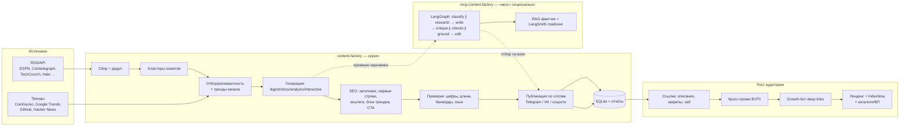

# Единая структура: автопостинг, тренды, SEO и рост аудитории

Один конвейер для сети из 6 Telegram-каналов (3 EN + 3 ES): сбор новостей и
трендов → отбор сюжетов → генерация с SEO → проверки качества → публикация
по расписанию → аналитика и привлечение аудитории.

Структура задаётся [config/unified.yaml](../config/unified.yaml), операции —
[scripts/unified.py](../scripts/unified.py). Рабочие настройки каналов и
LLM остаются в `config/settings.yaml` и `config/channels*.yaml`.

## Схема



## Кто за что отвечает

| Слой | Где | Роль |
|---|---|---|
| Источники и тренды | `content_factory/trends.py`, RSS-конфиги каналов | найти сюжеты и трендовые темы под каждый канал |
| Генерация + SEO | `content_factory/nlp/generator.py`, `config/channels*.yaml` | посты с ключевыми словами, хештегами, CTA |
| Расписание и публикация | `content_factory/scheduler.py`, `pipeline.py`, `.github/workflows/content-factory.yml` | 6 каналов × 15 постов/сутки по слотам |
| LLM-слой | `content_factory/nlp/llm.py`, `config/settings.yaml` | гибрид по этапам + автопереключение по лимитам |
| «Мозг» премиум-качества | `../mcp-content-factory` | LangGraph-роли, критик, редактура, RAG-фактчек |
| Аналитика | `content_factory/analytics/*`, `scripts/growth_report.py` | подписчики, просмотры, ER, топ-посты |
| Рост | `config/cross_promo.yaml`, `docs/promo/*`, `scripts/build_landing.py`, `scripts/telegram-growth-bot.py` | ссылки, закрепы, кросс-промо, хаб, каталоги |

## Расписание и объём

- 3 EN-канала (`config/channels.en.yaml`) + 3 ES (`config/channels.es.yaml`).
- У каждого канала `schedule` (15 слотов) и `posts_per_day: 15`
  → **90 постов в сутки**.
- Время слотов — локальное для канала (`timezone_offset` −5 для EN, −6 для ES);
  демон публикует, когда наступает слот.
- Production: `.github/workflows/content-factory.yml` (Cloudflare Worker
  `tg-cron` дёргает workflow) + резервный GitHub cron. Локально/на сервере:
  `python -m content_factory daemon` (долгоживущий) или
  `python scripts/unified.py tick --publish` (один тик).

Проверить ближайшие слоты и объём:

```bash
./.venv/bin/python scripts/unified.py status
```

## Тренды

`content_factory/trends.py` собирает тренды под тему канала и автоматически
добавляет их в генерацию (блок трендов в пиковые часы, SEO-теги). Источники:
CoinGecko (крипто), GitHub Trending и Hacker News (AI/tech), Google Trends
(регион US/MX), локальная частота сюжетов.

Отдельный сбор и сохранение для планирования:

```bash
./.venv/bin/python scripts/unified.py trends
# → data/trends/latest.json: тренды по каждому каналу + привязка к каналам
```

## SEO

Что уже включено в публикацию (не требует отдельных действий):

- ключевые слова темы в заголовке и первых строках (`generator.py`);
- хештеги канала + «SEO-теги» по трендам и анализу (`_seo_tags`);
- оптимизация заголовка отдельным проходом (`optimize.compact_headline`);
- блок трендов в пиковые часы;
- CTA/приглашение делиться;
- описания каналов с ключевыми словами и ссылками на сеть;
- лендинг-хаб `docs/index.html` + `IndexNow` для индексации;
- карточки каналов для каталогов (`docs/promo/catalog-package.md`).

Лендинг и IndexNow:

```bash
./.venv/bin/python scripts/build_landing.py
./.venv/bin/python scripts/indexnow_ping.py    # нужен INDEXNOW_KEY/LANDING_HOST
```

## Привлечение аудитории

- **Ссылки везде:** описания каналов, закрепы («Наша сеть»), хаб, каталоги,
  TikTok/YouTube/X/Instagram/био — реестр в
  [`docs/promo/link-placement.md`](promo/link-placement.md).
- **Кросс-промо:** `config/cross_promo.yaml` — нативные посты из большого
  канала в остальные (Вт/Пт 15:00 UTC, workflow `cross-promo`).
- **Growth-бот:** deep links `?start=<source>` и inline-режим
  (`scripts/telegram-growth-bot.py`) — атрибуция подписчиков по площадкам.
- **Лендинг-хаб:** единая ссылка для внешних био
  (https://valdislavn-spec.github.io/content-factory/).
- **Аналитика роста:** `scripts/growth_report.py` (подписчики, просмотры/ER,
  дельты, лучший пост), отчёт в Telegram по флагу `--send`.

## Добровольная поддержка (donate, не paywall)

В посты можно добавить необязательную donate-ссылку — только по желанию
читателя, контент остаётся бесплатным. Настройка и UTM-атрибуция:
[voluntary-support.md](voluntary-support.md), конфиг `config/support.yaml`.
По умолчанию URL пуст — блок выключен.

## Мост «мозга» в автопост (LangGraph + RAG)

Мост **включён**: content-factory отдаёт уже собранные топ-сюжеты (RSS +
кластеры) «мозгу» mcp-content-factory, тот генерирует пост пайплайном
LangGraph:

```
classify ∥ research → write → critique ∥ checks ∥ ground(RAG) → edit
```

Затем content-factory проверяет язык (EN/ES), добавляет хештеги, CTA и
источники и публикует пост по обычному расписанию. Для каждого поста «мозг»
делает 5 модельных вызовов; результат попадает в трейс LangSmith.

Включается в `config/settings.yaml`:

```yaml
pipeline:
  post_generator: brain        # internal | dify_app | brain
brain:
  enabled: true
  channels: [crypto-news, ai-news]   # топ-каналы; остальные — internal
  path: ../mcp-content-factory
  python: ../mcp-content-factory/.venv/bin/python
  config: ../mcp-content-factory/config/brain.json
  engine: langgraph
  grounding: true
  revision_rounds: 1
  timeout: 300
```

**Бесплатно.** В `mcp-content-factory/config/brain.json` цепочка моделей:
Cloudflare Workers AI → Cohere trial → Ollama Cloud; платный DeepSeek не
используется. Чтобы не выходить за бесплатные лимиты, по умолчанию включены
только 2 канала (30 постов/сутки × 5 ролей ≈ 150 вызовов); остальные каналы
генерятся встроенно. Добавить/убрать канал — `brain.channels`.

Выключить мост:

```bash
export CONTENT_FACTORY_BRAIN=off        # или post_generator: internal
# либо channels: []
```

**Fallback и Actions.** Исходники mcp-content-factory лежат в репозитории в
`vendor/mcp-content-factory` (пакет, config, pyproject; обновление —
`python scripts/sync_brain_vendor.py`). Рабочий процесс GitHub Actions
устанавливает его optional-шагом (`pip install -e "vendor/mcp-content-factory[langchain]"`)
и прогоняет mock-смоук `mcp_factory brain`; если установка или вызов не
удались, шаг не валит job, а мост возвращает `None` → внутренняя генерация.
Так один репозиторий самодостаточен, а автопостинг не останавливается.

Мост ищет мозг в порядке: env `CONTENT_FACTORY_BRAIN_PATH/PYTHON/CONFIG` →
`settings.yaml` → `vendor/mcp-content-factory` → соседний `../mcp-content-factory`.
В CI это автоматически даёт vendor + `sys.executable`, локально — dev-копию с
venv. Остановить мост: `CONTENT_FACTORY_BRAIN=off`.

Проверено в GitHub Actions (run 42422281901): шаги «Install brain engine» и
«Brain smoke test» — success, EN/ES тики прошли, трейс смоука виден в
LangSmith в проекте `content-factory-actions`. Если что-то из этого падает,
job остаётся зелёным, а посты генерируются internal-путём.

Проверка и превью:

```bash
./.venv/bin/python scripts/unified.py doctor   # пункт 5: «мост включён»
./.venv/bin/python scripts/unified.py status   # строка «Мост мозга»
./.venv/bin/python scripts/unified.py brain    # превью без публикации
```

Пример результата моста (EN-канал, реальные бесплатные модели): заголовок
`Bitcoin Surpasses $100,000 Milestone Amid Record ETF Inflows`, лид по
источникам, хештеги и CTA добавляет content-factory, пост уходит в обычную
очередь публикации.

## Ежедневный сценарий оператора

```bash
# 1. Проверить систему целиком (конфиги, расписание, LLM, ключи, SEO, рост)
./.venv/bin/python scripts/unified.py doctor

# 2. Посмотреть ближайшие публикации
./.venv/bin/python scripts/unified.py status

# 3. Собрать тренды (утром, до первых слотов)
./.venv/bin/python scripts/unified.py trends

# 4. Один тик автопостинга: dry-run безопасно, --publish — реально
./.venv/bin/python scripts/unified.py tick
./.venv/bin/python scripts/unified.py tick --publish

# 5. Полный дневной прогон: тренды + тик + отчёт роста
./.venv/bin/python scripts/unified.py daily

# 6. Превью премиум-генерации «мозгом» (LangGraph + RAG)
./.venv/bin/python scripts/unified.py brain
```

Production-расписание при этом не меняется: публикацию по слотам выполняет
GitHub Actions (`.github/workflows/content-factory.yml`), а `unified.py tick`
нужен для локального/серверного cron или ручной проверки.

## Конфиг `config/unified.yaml`

| Секция | Что задаёт |
|---|---|
| `pipeline` | файлы каналов, целевое число постов/сутки, режим расписания |
| `brain` | путь к mcp-content-factory, движок, grounding, раунды редактуры |
| `trends` | источники трендов, лимит на канал, путь сохранения |
| `seo` | какие SEO-механизмы включены, лендинг, IndexNow |
| `growth` | кросс-промо, закрепы, реестр ссылок, growth-бот, хаб |
| `quality` | проверки, RAG, трейсинг, лимит редактуры |
| `llm` | карта этапов и лимитов (истина — `config/settings.yaml`) |

## Проверка

```bash
python -m pytest tests/test_unified.py -q      # тесты пульта
./.venv/bin/python scripts/unified.py doctor   # readiness-отчёт
```
