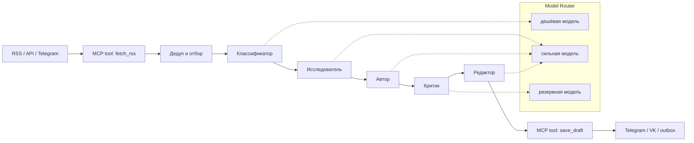

# MCP Content Factory

Контент-завод, собранный из **нескольких моделей** и **MCP-инструментов**:
оркестратор собирает новости, распределяет роли между LLM (исследователь,
автор, критик, редактор), проверяет факты по источникам и сохраняет готовый
пост. Всё работает офлайн на mock-моделях для демо и с реальными моделями
(Ollama, Gemini, GigaChat, Dify, OpenAI-совместимые API) — для продакшена.

```
RSS/API → MCP fetch_rss → дедуп → классификатор → исследователь →
автор → критик → редактор → MCP save_draft → (опционально) MCP publish_telegram
```

Ключевая идея: **модели не вызывают инструменты сами**. Оркестратор детерминированно
вызывает MCP-инструменты, а модели получают только текст и возвращают текст/JSON.
Это резко снижает риск, что инструкция, спрятанная в новости, заставит агента
что-то опубликовать или удалить.

## Что внутри

- **5 ролей моделей** с независимой маршрутизацией и fallback-цепочками.
- **Два движка**: встроенный пошаговый пайплайн и опциональный граф LangGraph
  с параллельными ветками, детерминированными проверками и раундами редактуры.
- **MCP-клиент и MCP-сервер** (stdio, JSON-RPC 2.0) без внешних зависимостей.
- **Совместимость с MCP 2026-07-28** (stateless, `_meta` в каждом запросе,
  `resultType`, `server/discover`) и с legacy 2025-11-25 (`initialize`).
- **Демо на mock-моделях**: не нужны токены, интернет и ключи.
- **Run-лог**: каждый вызов модели и инструмента, токены, ошибки, тайминги.
- **Dry-run публикации** по умолчанию: посты пишутся в `out/outbox/`.
- **Контракт инструментов**: `fetch_rss`, `list_channels`, `save_draft`,
  `publish_telegram`, `get_metrics`, `health`.

## Быстрый старт (0 обязательных зависимостей)

Нужен Python 3.9+.

```bash
cd mcp-content-factory
python3 -m mcp_factory demo --out out
```

Что произойдёт:

```
MCP: content_tools — 6 инструментов, протокол 2026-07-28
[1/6] собрано новостей: 6
[2/6] классификация: технологии и ИИ
[3/6] исследование: 3 фактов, источники [1, 4, 6]
[4/6] черновик: «…» (650 знаков)
[5/6] критик: revise (замечаний: 2)
[6/6] редактура: «…» (671 знаков)
Готово. Черновик: out/drafts/tech-ai-….md
Run-лог: out/runs/run-….json
```

Результаты:

- `out/drafts/<channel>-<timestamp>.md` — готовый пост с блоком источников;
- `out/drafts/<channel>-<timestamp>.json` — метаданные черновика;
- `out/runs/run-<timestamp>.json` — полный лог: роли, модели, токены,
  вызовы MCP-инструментов, ошибки.

Демо-новости вымышлены и лежат в `samples/*.xml`; ссылки ведут на
`example.com`.

## Как это устроено



### Роли и модели

| Роль | Что делает | В демо | Что ставить в жизни |
|---|---|---|---|
| `classifier` | тема, тональность, аудитория | `mock-classifier` | маленькая/быстрая: `qwen2.5:3b`, Gemini Flash-Lite |
| `researcher` | факты, цифры, ракурсы, номера источников | `mock-researcher` | контекстная: `qwen2.5:7b`, Gemini Flash |
| `writer` | черновик поста | `mock-writer` | лучшая по стилю: 7B–14B, Gemini Flash |
| `critic` | фактчек и замечания | `mock-critic` | строгая, `temperature: 0` |
| `editor` | финальная редактура | `mock-editor` | стабильный русский, 7B+ |

Маршрут каждой роли — это **цепочка** `provider/model`. Если первая модель
упала (нет ключа, таймаут, 429), роутер пробует следующую и пишет это в лог.

### Движок исполнения: pipeline или LangGraph

Один и тот же пайплайн можно исполнять двумя движками:

- `pipeline` (по умолчанию) — встроенный пошаговый оркестратор, 0 зависимостей;
- `langgraph` — те же шаги как узлы [LangGraph](https://www.langchain.com/langgraph).
  Независимые шаги идут параллельно (`classify ∥ research`, `critique ∥ checks`),
  после критика добавляются дешёвые детерминированные проверки, а
  `max_revision_rounds` разрешает повторную редактуру. Включается опционально:

```bash
# из каталога mcp-content-factory, в отдельном окружении (.venv в .gitignore)
python3 -m venv .venv && source .venv/bin/activate
pip install -e ".[langgraph]"      # Python 3.9 → langgraph 0.6.x, 3.10+ → 1.x
python -m mcp_factory demo --engine langgraph
python -m mcp_factory demo --engine langgraph --revision-rounds 2
python -m mcp_factory run --config config/ollama.json --engine langgraph
```

Граф детерминированный: модели по-прежнему не вызывают MCP-инструменты, узлы
делают это кодом. В run-логе появляются `engine`, `timings` узлов и
`duration_ms`. Checkpointers, human-in-the-loop и стриминг подключаются
штатными средствами LangGraph — см. [docs/langgraph.md](docs/langgraph.md).

### LangChain: трейсинг и RAG-фактчек (опционально)

LangGraph уже тянет `langchain-core` и `langsmith`; для RAG ставится пакет
`langchain` (Python 3.9 → ветка 0.3.x):

```bash
pip install -e ".[langchain]"
```

- **A. LangSmith-трейсинг** — `--tracing` (ключ `LANGSMITH_API_KEY` можно
  положить в `.env`): в веб-интерфейсе видно узлы графа, промпты, токены и
  ошибки. Без ключа трейсинг выключен.
- **B. RAG-фактчек** — `--grounding` + `--engine langgraph`: LangChain-сплиттер
  режет статьи на пассажи, BM25-ретривер сверяет цифры черновика с контекстом
  источников, замечания идут в общий merge к критику.
- **C. Agentic MCP** — экспериментально и только Python ≥3.10
  (`pip install -e ".[agentic]"`): модели сами вызывают MCP-инструменты, это
  ломает текущий принцип безопасности — в production не включаем.

Подробности и ограничения — [docs/langchain.md](docs/langchain.md).

### MCP-инструменты

| Инструмент | Назначение | Кто вызывает |
|---|---|---|
| `fetch_rss` | RSS/Atom → JSON-список новостей | оркестратор |
| `list_channels` | список каналов | оркестратор/UI |
| `save_draft` | сохранить пост + источники | оркестратор |
| `publish_telegram` | dry-run или публикация | оркестратор по флагу |
| `get_metrics` | статистика | оператор |
| `health` | проверка живости | оператор/мониторинг |

Модели **не** получают доступ к этим инструментам напрямую. Они возвращают
JSON с номерами использованных источников (`used`), а ссылки и блок
«Источники» собирает код из реально полученных новостей. Модель не может
подсунуть выдуманную ссылку.

## Живой запуск

### Вариант 1: Ollama (локально, бесплатно)

```bash
ollama serve
ollama pull qwen2.5:7b

python3 -m mcp_factory run --config config/ollama.json --out out-live
```

Если 7B медленно, замените в `config/ollama.json` модель на `qwen2.5:3b`.
Проверить, что Ollama отвечает:

```bash
curl http://127.0.0.1:11434/api/tags
```

### Вариант 2: Gemini

```bash
export GEMINI_API_KEY="ваш-ключ"
python3 -m mcp_factory run --config config/gemini.json --out out-gemini
```

Имена моделей в конфиге (`gemini-2.5-flash`) проверяйте в AI Studio: они
меняются. Помните, что бесплатный тариф может использовать данные для
улучшения продуктов, а доступ из РФ ограничен.

### Вариант 3: GigaChat

Добавьте в конфиг провайдер:

```json
{
  "providers": {
    "gigachat": {
      "type": "gigachat",
      "credentials_env": "GIGACHAT_CREDENTIALS",
      "scope": "GIGACHAT_API_PERS"
    }
  }
}
```

`GIGACHAT_CREDENTIALS` — base64-строка `client_id:client_secret` из личного
кабинета GigaChat API. Провайдер экспериментальный: проверьте его отдельно
перед продакшеном.

### Публикация в Telegram

1. Создайте бота у `@BotFather`, добавьте его администратором канала.
2. Задайте `TELEGRAM_BOT_TOKEN` и `pipeline.telegram_chat_id` в конфиге.
3. Запустите с `--publish`:

```bash
export TELEGRAM_BOT_TOKEN="123456:AA..."
python3 -m mcp_factory run --config config/ollama.json --publish
```

Без `--publish`, без токена или с `--allow-publish=false` сервер пишет файл в
`out/outbox/telegram-*.txt`. Это защита от случайной публикации.

## Свои MCP-серверы

В конфиге можно объявить несколько серверов:

```json
{
  "mcp": {
    "servers": {
      "content_tools": {"builtin": true},
      "filesystem": {
        "command": ["npx", "-y", "@modelcontextprotocol/server-filesystem", "/data"],
        "cwd": ".",
        "timeout": 30
      }
    }
  }
}
```

Оркестратор запускает все серверы, собирает список инструментов и вызывает
их по имени. Важно: пайплайн ожидает **контракт** `fetch_rss` / `save_draft` /
`publish_telegram`. Если внешний сервер отдаёт другие имена, нужен адаптер
(тонкий MCP-сервер, который переименовывает инструменты) или правка
оркестратора. Это сделано специально: инструменты — доверенный код, а не
произвольные действия модели.

### Подключить сервер к Claude Desktop / другому хосту

```json
{
  "mcpServers": {
    "content-factory": {
      "command": "python3",
      "args": [
        "-m", "mcp_factory.mcp_server",
        "--root", "/абсолютный/путь/к/out"
      ],
      "env": {"PYTHONPATH": "/абсолютный/путь/к/mcp-content-factory"}
    }
  }
}
```

Сервер поддерживает modern MCP и legacy `initialize`, поэтому подходит и
новым, и старым хостам.

## Свои модели

1. **Без кода** — используйте `openai_compatible` для любого API с
   `/chat/completions` (OpenAI, OpenRouter, vLLM, LM Studio, Together):

```json
{
  "providers": {
    "openrouter": {
      "type": "openai_compatible",
      "base_url": "https://openrouter.ai/api/v1",
      "api_key_env": "OPENROUTER_API_KEY"
    }
  },
  "routes": {
    "writer": {
      "chain": [{"provider": "openrouter", "model": "qwen/qwen-2.5-72b-instruct"}],
      "temperature": 0.5,
      "max_tokens": 1200
    }
  }
}
```

2. **Dify Cloud** — приложение Dify как провайдер (ключ приложения из
`API Access`, `app_mode: chat` для Chatbot/Agent/Chatflow или
`completion` для Text Generator):

```bash
export DIFY_API_KEY="app-..."
python3 -m mcp_factory run --config config/dify.json
```

Модель и параметры задаются в приложении Dify, а `model` в маршруте служит
меткой для логов. Подробности — в [docs/models.md](docs/models.md).

3. **С кодом** — добавьте класс-наследник `Provider` в
   `mcp_factory/models.py` и ветку в `build_provider`. Интерфейс:
   `complete(model, messages, temperature, max_tokens, json_mode) -> Completion`.

## Связка с `content-factory`

В workspace есть второй проект — [`../content-factory`](../content-factory/README.md):
готовый завод для 6 Telegram-каналов (RSS, дедуп, кластеризация, SQLite,
расписание, Telegram/VK, аналитика). Эти проекты дополняют друг друга:

| Слой | `content-factory` | `mcp-content-factory` |
|---|---|---|
| Сбор | RSS/веб/Telegram, БД, дедуп | MCP-инструмент `fetch_rss` |
| «Мозг» | extractive/Ollama/GigaChat | 5 ролей + маршрутизация + критик |
| Публикация | Telegram Bot API, VK, расписание | MCP `publish_telegram` / `save_draft` |
| Аналитика | отчёты, SQLite | run-логи JSON |

Варианты интеграции:

1. **Brain + hands**: этот оркестратор пишет черновики в `data/outbox/`
   `content-factory`, а тот публикует по расписанию.
2. **MCP-обёртка**: добавить MCP-инструмент `run_content_factory`, который
   вызывает `python -m content_factory run --channel ...` как подпроцесс.
3. **Единый пайплайн**: заменить в `content-factory` генерацию на вызов
   этого оркестратора, оставив сбор и публикацию как есть.

## Безопасность и ограничения

- **Новости — недоверенные данные.** В промптах есть явный запрет выполнять
  инструкции из текста. Но 100% защиты от prompt injection не существует:
  для чувствительных каналов нужен человек на подтверждении.
- **Инструменты вызывает код, а не модель.** Это главный предохранитель.
  Не переделывайте пайплайн в «агент сам решает, что вызвать», не добавив
  allowlist и подтверждение.
- **Dry-run по умолчанию.** Публикация — только с `--publish` и токеном.
- **Секреты — в env**, не в JSON-конфиге и не в git. Run-лог не пишет токены,
  но аргументы инструментов могут содержать текст поста.
- **SSRF.** `fetch_rss` разрешает любые `http(s)://`; в продакшене добавьте
  allowlist доменов и блокировку приватных IP.
- **Ограничения реализации:** только stdio, только tools (без resources и
  prompts), нет HTTP-авторизации, нет UI и очереди. Это учебный, но рабочий
  каркас; для продакшена смотрите официальный Python SDK и
  [spec 2026-07-28](https://modelcontextprotocol.io/specification/2026-07-28).

## Тесты

```bash
python3 -m unittest discover -s tests -v
```

57 тестов: modern discovery, legacy handshake, tools/call, dry-run публикации,
fallback роутера, бюджет токенов, JSON-ремонт, полный демо-пайплайн,
детерминированные проверки, граф LangGraph (параллельные ветки, раунды
редактуры), LangSmith-трейсинг и RAG-фактчек. Mock-модели делают тесты
детерминированными и не требуют сети.

Тесты LangGraph/LangChain пропускаются, если движок или LangChain не
установлены; отдельные тесты проверяют подсказки про установку.

## Структура

```
mcp-content-factory/
├── mcp_factory/
│   ├── cli.py            # команды demo/run/mcp-server/tools
│   ├── config.py         # JSON-конфиг и валидация
│   ├── models.py         # mock, Ollama, OpenAI-compatible, Gemini, GigaChat
│   ├── router.py         # роли → цепочки моделей, fallback, бюджет
│   ├── mcp_client.py     # MCP-клиент stdio (modern + legacy)
│   ├── mcp_server.py     # демо MCP-сервер и инструменты
│   ├── orchestrator.py   # пайплайн завода
│   ├── langgraph_flow.py # опциональный движок графа LangGraph
│   ├── quality.py        # детерминированные проверки черновика (без LLM)
│   ├── grounding.py      # RAG-фактчек на LangChain (пассажи + BM25)
│   ├── tracing.py        # LangSmith-трейсинг (опционально)
│   ├── prompts.py        # промпты ролей
│   ├── rendering.py      # сборка markdown-поста
│   ├── domain.py         # Article, ToolCall
│   └── utils.py          # JSON, текст, токены
├── config/               # demo.json, ollama.json, gemini.json, dify.json
├── samples/              # вымышленные RSS-ленты для офлайн-демо
├── tests/                # 57 unittest-тестов (часть skip без LangGraph/LangChain)
└── docs/                 # архитектура, MCP, модели, LangGraph
```

## Документация

| Документ | О чём |
|---|---|
| [docs/architecture.md](docs/architecture.md) | архитектура, роли, отказоустойчивость, безопасность, масштабирование |
| [docs/mcp.md](docs/mcp.md) | MCP 2026-07-28, handshake, инструменты, свой сервер, отладка |
| [docs/models.md](docs/models.md) | провайдеры, выбор моделей, промпты, стоимость, добавление модели |
| [docs/langgraph.md](docs/langgraph.md) | движок LangGraph: параллельные ветки, проверки, раунды редактуры, установка |
| [docs/langchain.md](docs/langchain.md) | LangSmith-трейсинг, RAG-фактчек, agentic MCP: установка и ограничения |
| [docs/integration.md](docs/integration.md) | как связать с content-factory, Telegram/VK и внешними API |

## Лицензия

MIT.
